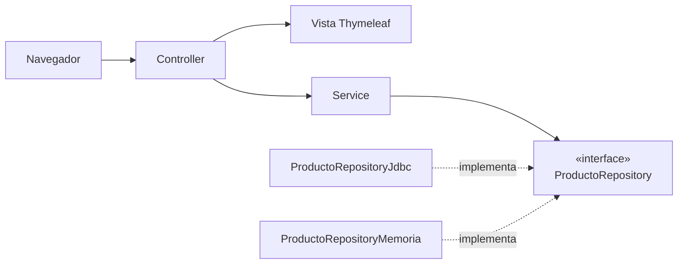

# SOLID y patrones de diseño en Spring MVC

## 1. La idea en 30 segundos

Un programa que funciona no es suficiente: tiene que poder **cambiarse sin romperse**. Los principios SOLID y los patrones son reglas que ya han demostrado ayudar a conseguirlo.

En Spring MVC se resumen en tres hábitos:

1. **Cada clase hace una sola cosa** (controlador, servicio, repositorio).
2. **Dependes de interfaces, no de implementaciones** y dejas que Spring te inyecte lo que necesitas.
3. **Si añadir una función obliga a modificar código que ya funciona, algo está mal diseñado.**

> En los ejemplos se omiten los `import` y el `throws SQLException` para que el código se lea mejor.

## 2. Punto de partida: el proyecto `Productos`

```
es.daw.productos
├── controller   → ProductoController        (HTTP y vistas)
├── service      → ProductoService            (reglas de negocio)
├── repository   → ProductoRepository         (interfaz)
│                  ProductoRepositoryJdbc     (implementación)
├── model        → Producto
└── form         → ProductoForm               (datos del formulario)
```



Regla de oro: **las flechas van siempre hacia la derecha**. El controlador conoce al servicio, el servicio conoce a la interfaz del repositorio, y nadie conoce a la implementación.

## 3. Los cinco principios SOLID

### S · Single Responsibility (una sola responsabilidad)

**Regla:** una clase debe tener **un solo motivo para cambiar**.

**Señal de alarma:** un controlador que abre conexiones, escribe SQL y calcula precios.

❌ **Mal:** el controlador lo hace todo.

```java
@Controller
public class ProductoController {

    @GetMapping("/productos/{id}")
    public String ver(@PathVariable int id, Model model) throws SQLException {
        // 1) acceso a datos: abre conexión, SELECT, ResultSet...
        // 2) lógica de negocio: if (precio > 100) { descuento... }
        // 3) preparar la vista
        return "producto";
    }
}
```

✅ **Bien:** cada capa con su trabajo.

```java
@Controller
@RequestMapping("/productos")
public class ProductoController {

    private final ProductoService service;

    public ProductoController(ProductoService service) {
        this.service = service;
    }

    @GetMapping("/{id}")
    public String ver(@PathVariable int id, Model model) {
        model.addAttribute("producto", service.buscar(id));   // solo HTTP y vista
        return "producto";
    }
}

@Service
public class ProductoService {

    private final ProductoRepository repository;

    public ProductoService(ProductoRepository repository) {
        this.repository = repository;
    }

    public Producto buscar(int id) {                          // solo reglas de negocio
        return repository.findById(id)
                .orElseThrow(() -> new ProductoNoEncontradoException(id));
    }
}
```

> `ProductoNoEncontradoException` es una excepción propia que extiende `RuntimeException`.

**Prueba rápida para comprobar si lo estás haciendo mal:** ¿el servicio usa `Model`, `HttpServletRequest` o `ResultSet`? Entonces mezcla capas.

---

### O · Open/Closed (abierto a ampliar, cerrado a modificar)

**Regla:** para añadir una función nueva, **escribes una clase nueva** en lugar de editar una que ya funciona.

**Señal de alarma:** un `if / else if` que crece cada vez que aparece un caso nuevo.

❌ **Mal:** cada descuento nuevo obliga a tocar el método.

```java
public double precioFinal(double precio, String tipo) {
    if (tipo.equals("NAVIDAD"))          return precio * 0.90;
    else if (tipo.equals("BLACKFRIDAY")) return precio * 0.70;
    else                                 return precio;
}
```

✅ **Bien:** patrón **Strategy** con beans de Spring.

```java
public interface Descuento {
    double aplicar(double precio);
}

@Component("NAVIDAD")
public class DescuentoNavidad implements Descuento {
    public double aplicar(double precio) { return precio * 0.90; }
}

@Component("SIN_DESCUENTO")
public class SinDescuento implements Descuento {
    public double aplicar(double precio) { return precio; }
}

@Service
public class PrecioService {

    // Spring inyecta TODOS los beans de tipo Descuento; la clave es el nombre del bean
    private final Map<String, Descuento> descuentos;

    public PrecioService(Map<String, Descuento> descuentos) {
        this.descuentos = descuentos;
    }

    public double precioFinal(double precio, String tipo) {
        return descuentos.getOrDefault(tipo, descuentos.get("SIN_DESCUENTO"))
                         .aplicar(precio);
    }
}
```

Para añadir `BLACKFRIDAY` creas `@Component("BLACKFRIDAY") class DescuentoBlackFriday ...` y **no tocas `PrecioService`**.

---

### L · Liskov Substitution (sustitución)

**Regla:** cualquier implementación de una interfaz debe poder **sustituir a otra sin que el código que la usa se entere**. Todas cumplen el mismo contrato.

**Señal de alarma:** una implementación que devuelve `null`, lanza `UnsupportedOperationException` o se comporta distinto a las demás.

❌ **Mal:** rompe el contrato de la interfaz.

```java
@Override
public Optional<Producto> findById(Integer id) {
    return null;   // la interfaz promete un Optional, y el servicio hace .orElseThrow()
}
```

✅ **Bien:** todas las implementaciones se comportan igual.

```java
@Override
public Optional<Producto> findById(Integer id) {
    return Optional.ofNullable(datos.get(id));   // si no existe: Optional.empty()
}
```

> Mientras desarrollas es normal dejar `throw new UnsupportedOperationException("Pendiente")` en un método. Lo que no puede pasar es que **la entrega final** lo conserve.

**Prueba rápida:** ¿puedo cambiar `ProductoRepositoryJdbc` por `ProductoRepositoryMemoria` y el servicio sigue funcionando igual?

---

### I · Interface Segregation (interfaces pequeñas)

**Regla:** nadie debe depender de métodos que **no usa**.

**Señal de alarma:** una clase que implementa una interfaz de siete métodos y deja cuatro vacíos.

❌ **Mal:** un servicio de consulta que depende de una interfaz que también borra y modifica.

✅ **Bien:** separar lectura y escritura.

```java
public interface ProductoLectura {
    Optional<Producto> findById(Integer id);
    List<Producto> findAll();
}

public interface ProductoEscritura {
    void save(Producto producto);
    void update(Producto producto);
    void delete(Integer id);
}

// Quien lo necesita todo, usa esta
public interface ProductoRepository extends ProductoLectura, ProductoEscritura { }

@Service
public class CatalogoService {

    private final ProductoLectura productos;   // solo puede leer

    public CatalogoService(ProductoLectura productos) {
        this.productos = productos;
    }
}
```

---

### D · Dependency Inversion (inversión de dependencias)

**Regla:** las clases de alto nivel (el servicio) dependen de **interfaces**, no de implementaciones concretas. Y no crean sus colaboradores con `new`: **se los dan**.

**Señal de alarma:** un `new` de un repositorio o un servicio dentro de otra clase.

❌ **Mal:** el servicio crea y conoce la implementación.

```java
@Service
public class ProductoService {
    private final ProductoRepository repository = new ProductoRepositoryJdbc();   // acoplado
}
```

✅ **Bien:** inyección por constructor de la **interfaz**.

```java
@Service
public class ProductoService {

    private final ProductoRepository repository;      // interfaz + final

    public ProductoService(ProductoRepository repository) {
        this.repository = repository;                 // Spring decide cuál inyectar
    }
}
```

**Lo que ganas:** cambiar de JDBC a memoria (o a JPA en la UT04) **sin tocar el servicio**.

```java
@Repository
@Profile("jdbc")
public class ProductoRepositoryJdbc implements ProductoRepository { /* ... */ }

@Repository
@Profile("memoria")
public class ProductoRepositoryMemoria implements ProductoRepository {
    private final Map<Integer, Producto> datos = new ConcurrentHashMap<>();
    /* ... */
}
```

```properties
# application.properties: cambias una línea y arranca con otra implementación
spring.profiles.active=memoria
```

> **Inyección por constructor, siempre.** Nada de `@Autowired` sobre atributos: IntelliJ te avisa con *Field injection is not recommended*. Cuando domines el constructor explícito puedes sustituirlo por `@RequiredArgsConstructor` de Lombok con atributos `final`.

> **¿Interfaz también para el servicio?** No por costumbre. Ponla cuando haya (o vaya a haber) varias implementaciones. En el repositorio sí, porque ahí cambiarás JDBC por JPA.

## 4. Patrones que usarás en la UT02

| Patrón | Problema que resuelve | En tu proyecto |
|---|---|---|
| **MVC** | Separar vista, lógica y datos | `@Controller` + Thymeleaf + `Model` |
| **Inyección de dependencias (IoC)** | No hacer `new` de colaboradores | Constructor + `@Service` / `@Repository` / `@Component` |
| **Repository** | Acceso a datos detrás de una interfaz | `ProductoRepository` |
| **Service** | Reglas de negocio en un solo sitio | `ProductoService` |
| **DTO / Form** | Mover datos a la vista sin exponer el modelo | `ProductoForm` |
| **Singleton** | Una sola instancia | Los beans de Spring lo son por defecto |
| **Strategy** | Cambiar un algoritmo sin `if / else` | `Descuento` + sus implementaciones |

### DTO / Form: datos del formulario

Según la convención de clase: **clase con Lombok para los formularios Thymeleaf** y **`record` para los DTO de una API REST**.

```java
@Data
public class ProductoForm {

    @NotBlank(message = "El nombre es obligatorio")
    private String nombre;

    @Positive(message = "El precio debe ser mayor que 0")
    private double precio;
}
```

```java
@PostMapping
public String crear(@Valid @ModelAttribute ProductoForm form, BindingResult errores) {
    if (errores.hasErrors()) {
        return "producto-form";                 // vuelve al formulario con los errores
    }
    service.crear(form);                        // el servicio convierte el form en Producto
    return "redirect:/productos";
}
```

**Por qué no usar `Producto` directamente en el formulario:** el formulario puede incluir campos que el modelo no debe recibir del navegador (por ejemplo, el `id`).

### Singleton: cuidado con el estado

Spring crea **una sola instancia** de cada `@Service` y la comparten **todos los usuarios a la vez**.

❌ **Mal:**

```java
@Service
public class ProductoService {
    private Producto ultimoVisto;   // lo ven y lo pisan todos los usuarios
}
```

✅ **Bien:** un servicio **no guarda datos de un usuario**. Si hay que recordar algo de cada usuario, va en la sesión (se verá con RA4) o se pasa como parámetro.

---

## 5. Chuleta de IntelliJ (Windows y Linux)

| Quiero... | Atajo |
|---|---|
| Generar constructor, getters... | `Alt + Insert` |
| Menú de refactorización (*Extract Interface*, *Extract Method*...) | `Ctrl + Alt + Shift + T` |
| Extraer un método | `Ctrl + Alt + M` |
| Renombrar | `Shift + F6` |
| Mover una clase a otro paquete | `F6` |
| Ir a las implementaciones de una interfaz | `Ctrl + Alt + B` |
| Ver quién usa esta clase | `Alt + F7` |
| Diagrama de clases (Ultimate) | `Ctrl + Alt + Shift + U` |
| Cambiar de perfil | *Run → Edit Configurations → Active profiles* |

**Flujo típico para separar capas:** sobre una clase `ProductoRepositoryJdbc`, `Ctrl + Alt + Shift + T` → *Extract Interface* → marcas los métodos y obtienes `ProductoRepository`.


