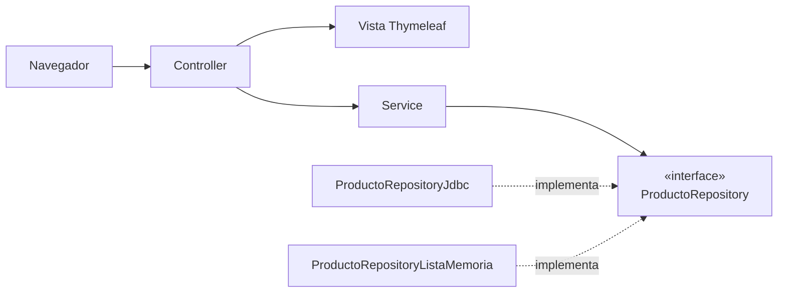

# SOLID y patrones de diseño en Spring MVC

## 1. La idea en 30 segundos

Un programa que funciona no es suficiente: tiene que poder **cambiarse sin romperse**. Los principios SOLID y los patrones son reglas que ya han demostrado ayudar a conseguirlo.

En Spring MVC se resumen en tres hábitos:

1. **Cada clase hace una sola cosa** (controlador, servicio, repositorio).
2. **Dependes de interfaces, no de implementaciones** y dejas que Spring te inyecte lo que necesitas.
3. **Si añadir una función obliga a modificar código que ya funciona, algo está mal diseñado.**

> En los ejemplos se omiten los `import` y el `throws SQLException` para que el código se lea mejor.

## 2. Punto de partida: el proyecto `Productos`

```
es.daw.productos
├── controller   → ProductoController        (HTTP y vistas)
├── service      → ProductoService            (reglas de negocio)
├── repository   → ProductoRepository         (interfaz)
│                  ProductoRepositoryJdbc     (implementación)
│                  ProductoRepositoryListaMemoria (implementación)
├── model        → Producto
└── form         → ProductoForm               (datos del formulario)
```



Regla de oro: **las flechas van siempre hacia la derecha**. El controlador conoce al servicio, el servicio conoce a la interfaz del repositorio, y nadie conoce a la implementación.

## 3. Los cinco principios SOLID

### S · Single Responsibility (una sola responsabilidad)

**Regla:** una clase debe tener **un solo motivo para cambiar**.

**Señal de alarma:** un controlador que abre conexiones, escribe SQL y calcula precios.

❌ **Mal:** el controlador lo hace todo.

```java
@Controller
public class ProductoController {

    @GetMapping("/productos/{id}")
    public String ver(@PathVariable int id, Model model) throws SQLException {
        // 1) acceso a datos: abre conexión, SELECT, ResultSet...
        // 2) lógica de negocio: if (precio > 100) { descuento... }
        // 3) preparar la vista
        return "producto";
    }
}
```

✅ **Bien:** cada capa con su trabajo.

```java
@Controller
@RequestMapping("/productos")
public class ProductoController {

    private final ProductoService service;

    public ProductoController(ProductoService service) {
        this.service = service;
    }

    @GetMapping("/{id}")
    public String ver(@PathVariable int id, Model model) {
        model.addAttribute("producto", service.buscar(id));   // solo HTTP y vista
        return "producto";
    }
}

@Service
public class ProductoService {

    private final ProductoRepository repository;

    public ProductoService(ProductoRepository repository) {
        this.repository = repository;
    }

    public Producto buscar(int id) {                          // solo reglas de negocio
        return repository.findById(id)
                .orElseThrow(() -> new ProductoNoEncontradoException(id));
    }
}
```

> `ProductoNoEncontradoException` es una excepción propia que extiende `RuntimeException`.

**Prueba rápida para comprobar si lo estás haciendo mal:** ¿el servicio usa `Model`, `HttpServletRequest` o `ResultSet`? Entonces mezcla capas.

---

### O · Open/Closed (abierto a ampliar, cerrado a modificar)

**Regla:** para añadir una función nueva, **escribes una clase nueva** en lugar de editar una que ya funciona.

**Señal de alarma:** un `if / else if` que crece cada vez que aparece un caso nuevo.

❌ **Mal:** cada descuento nuevo obliga a tocar el método.

```java
public double precioFinal(double precio, String tipo) {
    if (tipo.equals("NAVIDAD"))          return precio * 0.90;
    else if (tipo.equals("BLACKFRIDAY")) return precio * 0.70;
    else                                 return precio;
}
```

✅ **Bien:** patrón **Strategy** con beans de Spring. Cada descuento es una clase y **sabe a qué tipo se aplica**.

```java
public interface Descuento {
    boolean soporta(String tipo);
    double aplicar(double precio);
}

@Component
public class DescuentoNavidad implements Descuento {
    public boolean soporta(String tipo) { return "NAVIDAD".equals(tipo); }
    public double aplicar(double precio) { return precio * 0.90; }
}

@Service
public class PrecioService {

    // Spring inyecta en la lista TODOS los beans que implementan Descuento
    private final List<Descuento> descuentos;

    public PrecioService(List<Descuento> descuentos) {
        this.descuentos = descuentos;
    }

    public double precioFinal(double precio, String tipo) {
        for (Descuento d : descuentos) {
            if (d.soporta(tipo)) {
                return d.aplicar(precio);
            }
        }
        return precio;   // ningún descuento aplica
    }
}
```

Para añadir `BLACKFRIDAY` creas `DescuentoBlackFriday` con `@Component` y **no tocas `PrecioService`**: Spring lo mete en la lista solo.

> **"¡Pero sigue habiendo un `if`!"** Sí, pero **nunca crece**. El `if / else if` del ejemplo malo tenía una rama por cada descuento; este es siempre el mismo, haya 2 descuentos o 20.

---

### L · Liskov Substitution (sustitución)

**Regla:** si el servicio funciona con una implementación de la interfaz, **tiene que funcionar igual con cualquier otra**. Cambiar `ProductoRepositoryJdbc` por `ProductoRepositoryListaMemoria` no puede romper nada.

**Idea clave:** una interfaz no es solo una lista de métodos, es una **promesa**. Implementarla significa cumplir la promesa, no solo conseguir que compile.

> **Analogía:** cualquier cargador USB-C vale para tu móvil. Uno que encaja en el puerto pero no carga "implementa" USB-C... y rompe el contrato.

**Señal de alarma:** una implementación que devuelve `null`, lanza `UnsupportedOperationException` o se comporta distinto a las demás.

#### 1. La promesa (el contrato)

```java
public interface ProductoRepository {

    /** Devuelve el producto, o Optional.empty() si no existe. Nunca null. */
    Optional<Producto> findById(Integer id);

    /** Devuelve todos los productos, o una lista vacía si no hay. Nunca null. */
    List<Producto> findAll();
}
```

#### 2. El servicio confía en la promesa

```java
public Producto buscar(int id) {
    return repository.findById(id)
            .orElseThrow(() -> new ProductoNoEncontradoException(id));
}
```

El servicio no sabe qué implementación tiene debajo, y no debe saberlo.

#### 3. Una implementación que no la cumple

❌ **Mal:** compila, pero rompe la promesa.

```java
@Repository
public class ProductoRepositoryListaMemoria implements ProductoRepository {

    private final List<Producto> productos = new ArrayList<>();

    @Override
    public Optional<Producto> findById(Integer id) {
        for (Producto p : productos) {
            if (p.getId().equals(id)) {
                return Optional.of(p);
            }
        }
        return null;                              // promete Optional y devuelve null
    }
}
```

Mismo servicio, misma llamada `buscar(99)` con un id que no existe:

| Implementación | Resultado |
|---|---|
| `ProductoRepositoryJdbc` | `ProductoNoEncontradoException` → error controlado ✅ |
| `ProductoRepositoryListaMemoria` | `NullPointerException` en el **servicio** 💥 |

**El error salta en el servicio, pero el culpable es el repositorio.** Por eso estos fallos cuestan tanto de encontrar.

✅ **Bien:** la única diferencia está en la última línea.

```java
@Override
public Optional<Producto> findById(Integer id) {
    for (Producto p : productos) {
        if (p.getId().equals(id)) {
            return Optional.of(p);
        }
    }
    return Optional.empty();                      // si no existe: Optional vacío
}
```

**Prueba rápida:** pon `@Primary` en cada implementación (lo verás en la D) y busca un id que no existe. Si el resultado cambia, alguna incumple el contrato.

---

### I · Interface Segregation (interfaces pequeñas)

**Regla:** ninguna clase debe estar obligada a implementar métodos que **no usa**, ni a depender de ellos.

**Idea clave:** mejor varias interfaces pequeñas que una grande "para todo".

**Señal de alarma:** métodos que devuelven `0` o `null`, o lanzan `UnsupportedOperationException`, *"porque en esta clase no tiene sentido"*.

**Escenario:** la tienda vende libros en papel (se envían) y ebooks (se descargan).

❌ **Mal:** una interfaz que sirve para todo.

```java
public interface Articulo {
    String getNombre();
    double getPrecio();
    double getPesoKg();        // para calcular el envío
    String getUrlDescarga();   // para productos digitales
}

public class LibroPapel implements Articulo {
    /* nombre, precio, peso... */

    @Override
    public String getUrlDescarga() {
        throw new UnsupportedOperationException();   // un libro de papel no se descarga
    }
}

public class Ebook implements Articulo {
    /* nombre, precio, url... */

    @Override
    public double getPesoKg() {
        return 0;                                     // ¿pesa 0 kg? ¿y si alguien calcula su envío?
    }
}
```

Las dos clases están **obligadas a mentir** para que el código compile. Y son justo las señales de alarma de Liskov.

✅ **Bien:** una interfaz por capacidad.

```java
public interface Articulo {
    String getNombre();
    double getPrecio();
}

public interface Enviable {
    double getPesoKg();
}

public interface Descargable {
    String getUrlDescarga();
}

public class LibroPapel     implements Articulo, Enviable              { /* ... */ }
public class Ebook          implements Articulo, Descargable           { /* ... */ }
public class PackLibroEbook implements Articulo, Enviable, Descargable { /* ... */ }
```

Cada servicio pide **solo lo que necesita**:

```java
@Service
public class EnvioService {
    public double calcularCoste(Enviable articulo) {
        return 3.0 + articulo.getPesoKg() * 1.5;
    }
}

@Service
public class DescargaService {
    public String generarEnlace(Descargable articulo) {
        return articulo.getUrlDescarga() + "?token=" + UUID.randomUUID();
    }
}
```

---
### D · Dependency Inversion (inversión de dependencias DIP)

**Regla:** los componentes de alto nivel (el servicio) dependen de **interfaces**, no de implementaciones concretas. Y nunca hacen `new` de otro componente: **Spring lo crea y se lo inyecta**.

**Señal de alarma:** un `new` de un repositorio o de un servicio dentro de otro componente.

❌ **Mal:** el servicio crea el repositorio y conoce la implementación.

```java
@Service
public class ProductoService {
    private final ProductoRepository repository = new ProductoRepositoryJdbc();   // acoplado
}
```

✅ **Bien:** inyección por constructor de la **interfaz**.

```java
@Service
public class ProductoService {

    private final ProductoRepository repository;      // interfaz + final

    public ProductoService(ProductoRepository repository) {
        this.repository = repository;                 // Spring decide cuál inyectar
    }
}
```

**Lo que ganas:** cambiar de JDBC a una lista en memoria (por ejemplo, para probar sin base de datos) **sin tocar el servicio**:

```java
@Repository
public class ProductoRepositoryJdbc implements ProductoRepository { /* SQL con JDBC */ }

@Repository
@Primary                                              // ← Spring inyecta esta
public class ProductoRepositoryListaMemoria implements ProductoRepository {
    private final List<Producto> productos = new ArrayList<>();
    /* ... */
}
```

> **Dos componentes que implementan la misma interfaz:** Spring no sabe cuál inyectar y la aplicación no arranca (*"required a single bean, but 2 were found"*). Con `@Primary` le indicas cuál usar. Para volver a JDBC, mueves `@Primary` a la otra clase. **El servicio no se entera.**

> **Inyección por constructor, siempre.** Nada de `@Autowired` sobre atributos: IntelliJ te avisa con *Field injection is not recommended*. Cuando domines el constructor explícito puedes sustituirlo por `@RequiredArgsConstructor` de Lombok con atributos `final`.


##### Inversión de dependencias (DIP) e inyección de dependencias (DI)

Se parecen en el nombre, pero no son lo mismo:

| | Inversión de dependencias (DIP, la "D" de SOLID) | Inyección de dependencias (DI) |
|---|---|---|
| Qué es | Un **principio**: cómo diseñar | Una **técnica**: cómo conseguir los objetos que usas |
| Dice | Depende de **interfaces**, no de clases concretas | No hagas `new`: que te den los objetos **desde fuera** (por el constructor) |
| Pregunta que responde | ¿*De qué* dependo? | ¿*Quién* me da lo que necesito? |
| Spring | No lo hace por ti: es una decisión tuya al diseñar | Lo hace por ti: es su contenedor |
| Ejemplo en el proyecto | `UsuarioDetailsService` depende de la interfaz `UsuarioRepository` | Spring le pasa por el constructor la implementación (`UsuarioRepositoryMemoria`) |

> **DIP es *de qué* dependes (de una interfaz); DI es *cómo* te llega (te la inyecta Spring).** Juntas permiten cambiar una implementación por otra sin tocar las clases que la usan. Por eso en la UT04 sustituiremos `UsuarioRepositoryMemoria` por una versión con JPA y `UsuarioDetailsService` no cambiará.

---

## 4. Patrones a usar

> **¿Qué es la Gang of Four (GoF)?** Así se conoce a los cuatro autores (Gamma, Helm, Johnson y Vlissides) del libro *Design Patterns* (1994), que recogió **23 patrones** que siguen siendo la referencia. Los agrupan en tres tipos:
>
> | Tipo | Para qué sirven | Ejemplos que ya conoces |
> |---|---|---|
> | **Creacionales** | Cómo se crean los objetos | Singleton, Builder |
> | **Estructurales** | Cómo se combinan las clases | Decorator (`new BufferedReader(new FileReader(...))`) |
> | **De comportamiento** | Cómo se comunican los objetos | Iterator (el `for` que recorre una `List`) |
>
> De la tabla de abajo, solo **Singleton** y **Builder** son de la GoF. MVC, Repository, Service y DTO son patrones de arquitectura que aparecieron por otras vías, pero se usan igual.

| Patrón | Problema que resuelve | En tu proyecto |
|---|---|---|
| **MVC** | Separar vista, lógica y datos | `@Controller` + Thymeleaf + `Model` |
| **Inyección de dependencias (IoC)** | No hacer `new` de otros componentes | Constructor + `@Service` / `@Repository` / `@Component` |
| **Repository** | Acceso a datos detrás de una interfaz | `ProductoRepository` |
| **Service** | Reglas de negocio en un solo sitio | `ProductoService` |
| **DTO / Form** | Mover datos a la vista sin exponer el modelo | `ProductoForm` |
| **Singleton** | Una sola instancia | Los beans de Spring lo son por defecto |
| **Builder** | Crear objetos con muchos atributos de forma legible | `Producto.builder()...build()` (Lombok `@Builder`) |

### DTO / Form: datos del formulario

Según la convención de clase: **clase con Lombok para los formularios Thymeleaf** y **`record` para los DTO de una API REST**.

```java
@Data
public class ProductoForm {

    @NotBlank(message = "El nombre es obligatorio")
    private String nombre;

    @Positive(message = "El precio debe ser mayor que 0")
    private double precio;
}
```

```java
@PostMapping
public String crear(@Valid @ModelAttribute ProductoForm form, BindingResult errores) {
    if (errores.hasErrors()) {
        return "producto-form";                 // vuelve al formulario con los errores
    }
    service.crear(form);                        // el servicio convierte el form en Producto
    return "redirect:/productos";
}
```

**Por qué no usar `Producto` directamente en el formulario:** el formulario puede incluir campos que el modelo no debe recibir del navegador (por ejemplo, el `id`).

### Singleton: cuidado con el estado

Spring crea **una sola instancia** de cada `@Service` y la comparten **todos los usuarios a la vez**.

❌ **Mal:**

```java
@Service
public class ProductoService {
    private Producto ultimoVisto;   // lo ven y lo pisan todos los usuarios
}
```

✅ **Bien:** un servicio **no guarda datos de un usuario**. Si hay que recordar algo de cada usuario, va en la sesión (se verá con RA4) o se pasa como parámetro.


### Singleton a mano

```java
public class ContadorVisitas {

    private static final ContadorVisitas INSTANCIA = new ContadorVisitas();   // 1) la única instancia

    private int visitas = 0;

    private ContadorVisitas() { }                    // 2) constructor privado: nadie puede hacer new

    public static ContadorVisitas getInstance() {    // 3) único punto de acceso
        return INSTANCIA;
    }

    public void registrar() { visitas++; }
    public int getVisitas() { return visitas; }
}
```

```java
ContadorVisitas a = ContadorVisitas.getInstance();
ContadorVisitas b = ContadorVisitas.getInstance();

a.registrar();
b.registrar();

System.out.println(a.getVisitas());   // 2  → a y b son el mismo objeto
System.out.println(a == b);           // true

new ContadorVisitas();                // ❌ no compila: el constructor es privado
```

Las tres piezas: **atributo `static`**, **constructor `private`** y **método `static` `getInstance()`**.

> **En Spring no lo escribes tú:** cada `@Service`, `@Repository` o `@Component` ya es un singleton. Spring crea la única instancia y te la inyecta.

### Builder: crear objetos con muchos atributos

**Problema:** un constructor con muchos parámetros no hay quien lo lea.

```java
Producto p = new Producto(1, "Teclado", 29.99, 10);   // ¿10 qué? ¿unidades? ¿descuento?
```

Si te equivocas de orden y dos parámetros son del mismo tipo, **compila igual** y el error no aparece hasta que ves los datos mal.

**Solución:** construir el objeto **paso a paso, nombrando cada atributo**.

```java
Producto p = Producto.builder()
        .id(1)
        .nombre("Teclado")
        .precio(29.99)
        .stock(10)
        .build();
```

Se lee solo, el orden da igual y puedes omitir los atributos que no necesites.

#### Sin Lombok: así funciona por dentro

```java
public class Producto {

    private final Integer id;
    private final String nombre;
    private final double precio;
    private final int stock;

    private Producto(Builder b) {                    // 1) constructor privado: solo lo usa el Builder
        this.id = b.id;
        this.nombre = b.nombre;
        this.precio = b.precio;
        this.stock = b.stock;
    }

    public static Builder builder() {                // 2) punto de entrada
        return new Builder();
    }

    public static class Builder {                    // 3) clase interna que va guardando los valores
        private Integer id;
        private String nombre;
        private double precio;
        private int stock;

        public Builder id(Integer id)         { this.id = id;         return this; }   // 4) devuelve this
        public Builder nombre(String nombre)  { this.nombre = nombre; return this; }   //    para encadenar
        public Builder precio(double precio)  { this.precio = precio; return this; }
        public Builder stock(int stock)       { this.stock = stock;   return this; }

        public Producto build() {                    // 5) crea el objeto final
            return new Producto(this);
        }
    }
}
```

La clave está en el `return this`: cada método devuelve el mismo Builder, y por eso se pueden **encadenar** las llamadas.

#### Con Lombok: una anotación

```java
@Data
@Builder
@NoArgsConstructor
@AllArgsConstructor
public class Producto {
    private Integer id;
    private String nombre;
    private double precio;
    private int stock;
}
```

`@Builder` genera **todo** el código del apartado anterior.

> **¿Por qué `@NoArgsConstructor` y `@AllArgsConstructor`?** `@Builder` necesita un constructor con todos los atributos, y al generarlo **desaparece el constructor vacío**. Spring lo necesita para rellenar formularios (y JPA lo necesitará en las entidades). Con estas dos anotaciones tienes los dos.

> **Valores por defecto:** si escribes `private int stock = 5;`, el builder **lo ignora** y deja `0`. Para que lo respete: `@Builder.Default private int stock = 5;`

#### Dónde lo usarás: convertir el formulario en modelo

```java
@Service
public class ProductoService {

    public void crear(ProductoForm form) {
        Producto producto = Producto.builder()
                .nombre(form.getNombre())
                .precio(form.getPrecio())
                .build();                            // sin id: lo pone la base de datos
        repository.save(producto);
    }
}
```

| | Constructor | Builder |
|---|---|---|
| Legibilidad | `new Producto(1, "Teclado", 29.99, 10)` | Cada valor con su nombre |
| Orden de los parámetros | Obligatorio | Da igual |
| Atributos opcionales | Un constructor por combinación | Los omites y listo |
| Código que escribes | Poco | Mucho a mano, nada con Lombok |
| Olvidar un atributo | **No compila**: el compilador te avisa | **Compila**: nadie te avisa (queda `null` o `0`) |

#### ¿Entonces cuándo lo uso?

Que sea un patrón **creacional** significa que trata de **cómo se crean los objetos**, no que haya que usarlo para crearlos todos. Un patrón resuelve un problema concreto: **si no tienes el problema, no lo apliques**.

Para decidir, pregúntate **quién crea el objeto**:

- **Lo creas tú** en tu código (mapper, `mapRow`, servicio, tests) y tiene **muchos atributos** → **Builder**.
- **Lo crea Spring** (al enviar un formulario, o un componente) → Spring usa el **constructor vacío + setters**. El builder no le sirve de nada.

| Clase | ¿Quién la crea? | ¿Builder? |
|---|---|---|
| Modelo (`Producto`, `Libro`) | **Tú**: mapper, `mapRow`, tests | ✅ Sí |
| DTO de formulario (`ProductoForm`, `LibroDto`) | **Spring** al enviar el formulario (POST)<br>**Tú** en `mapper.toDto` para rellenar el formulario de edición | ✅ Sí, para el `toDto`, **sin quitar** `@NoArgsConstructor` (lo usa Spring) |
| Entidad JPA (UT04) | **Hibernate** al leer de la BD<br>**Tú** al crear una nueva para guardarla | ✅ Sí, con `@NoArgsConstructor` (lo usa Hibernate) y `@Builder.Default` en las listas |
| Clase con 2 o 3 atributos de tipos distintos (`Autor`) | Tú | Opcional: `new Autor(1, "Cortázar")` ya se lee bien. Si el resto del proyecto usa builder, úsalo también por coherencia |
| Componentes (`@Service`, `@Repository`...) | **Spring** | ❌ Nunca |

> **Por eso el DTO lleva las tres anotaciones:** `@Builder` y `@AllArgsConstructor` para cuando lo creas tú; `@NoArgsConstructor` para cuando lo crea Spring.

```java
// Lo creas tú: builder
public LibroDto toDto(Libro libro) {
    return LibroDto.builder()
            .isbn(libro.getIsbn())
            .titulo(libro.getTitulo())
            .edicion(true)
            .build();
}

// Lo crea Spring: constructor vacío + setters (no escribes nada)
@PostMapping("/guardar")
public String guardar(@Valid @ModelAttribute LibroDto libroDto, BindingResult errores) { ... }
```

> **Para la UT04: Builder en entidades JPA.** Es el mismo caso que el DTO. Hibernate crea la entidad al leer de la BD con el **constructor vacío + setters**, y tú la creas con el builder. Hay que tener cuidado con tres cosas:
>
> 1. **`@NoArgsConstructor`, obligatorio.** Sin él, Hibernate no puede crear la entidad y falla al leer de la BD.
> 2. **Las listas inicializadas necesitan `@Builder.Default`.** Si no, el builder ignora el `= new ArrayList<>()` y la lista queda a `null`.
> 3. **Relaciones bidireccionales y `@Data`.** Si `Autor` tiene sus `libros` y cada `Libro` tiene su `autor`, `toString()` y `hashCode()` se llaman entre sí sin fin y provocan un `StackOverflowError`. Excluye la lista con `@ToString.Exclude` y `@EqualsAndHashCode.Exclude`.
>
> ```java
> @Entity
> @Data
> @Builder
> @NoArgsConstructor                         // ← lo usa Hibernate
> @AllArgsConstructor                        // ← lo usa @Builder
> public class Autor {
>
>     @Id
>     @GeneratedValue(strategy = GenerationType.IDENTITY)
>     private Integer id;
>
>     private String nombre;
>
>     @OneToMany(mappedBy = "autor")
>     @Builder.Default                       // ← sin esto, libros = null
>     @ToString.Exclude                      // ← evitan el bucle infinito
>     @EqualsAndHashCode.Exclude             //   con Libro.autor
>     private List<Libro> libros = new ArrayList<>();
> }
> ```
>
> ```java
> Autor autor = Autor.builder().nombre("Cortázar").build();
> autor.getLibros().add(libro);              // sin @Builder.Default: NullPointerException
> ```

> ⚠️ **Builder evita los errores de orden, no los olvidos.** Si añades un atributo nuevo (por ejemplo, `ejemplares`), todo sigue compilando: busca con `Alt + F7` los usos de `Libro.builder()` y añádelo donde haga falta.

---


## 5. Chuleta de IntelliJ (Windows y Linux)

| Quiero... | Atajo |
|---|---|
| Generar constructor, getters... | `Alt + Insert` |
| Menú de refactorización (*Extract Interface*, *Extract Method*...) | `Ctrl + Alt + Shift + T` |
| Extraer un método | `Ctrl + Alt + M` |
| Renombrar | `Shift + F6` |
| Mover una clase a otro paquete | `F6` |
| Ir a las implementaciones de una interfaz | `Ctrl + Alt + B` |
| Ver quién usa esta clase | `Alt + F7` |
| Diagrama de clases (Ultimate) | `Ctrl + Alt + Shift + U` |

**Flujo típico para separar capas:** sobre una clase `ProductoRepositoryJdbc`, `Ctrl + Alt + Shift + T` → *Extract Interface* → marcas los métodos y obtienes `ProductoRepository`.


