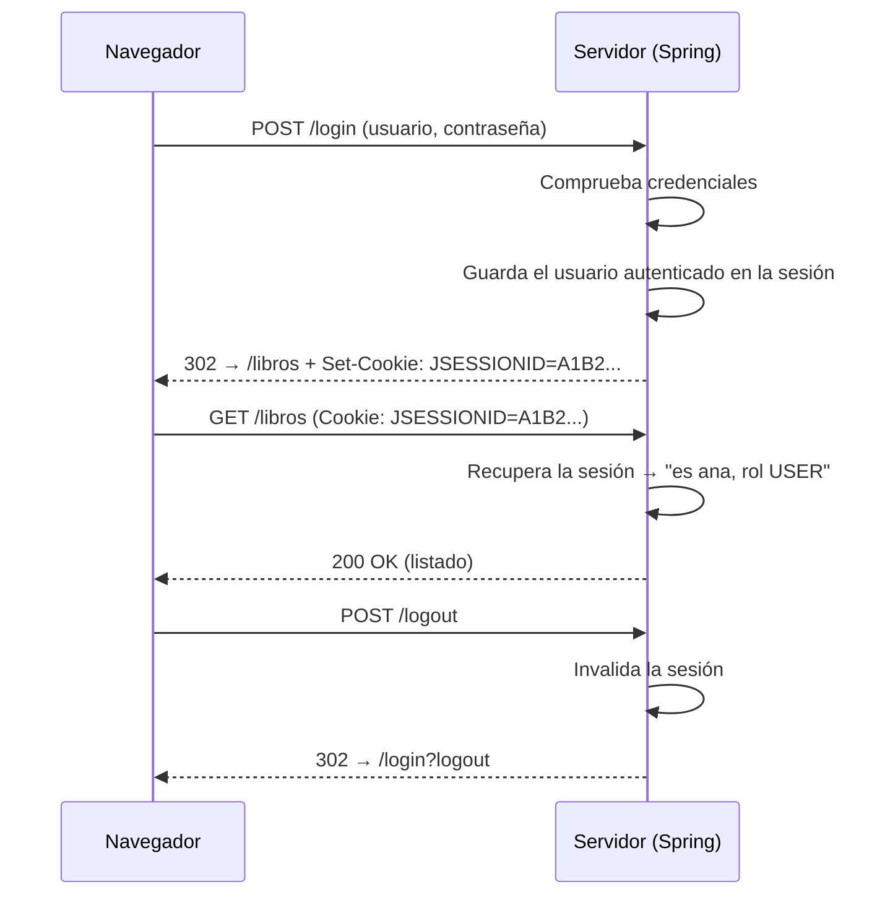
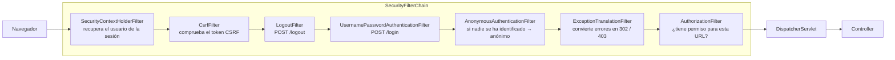
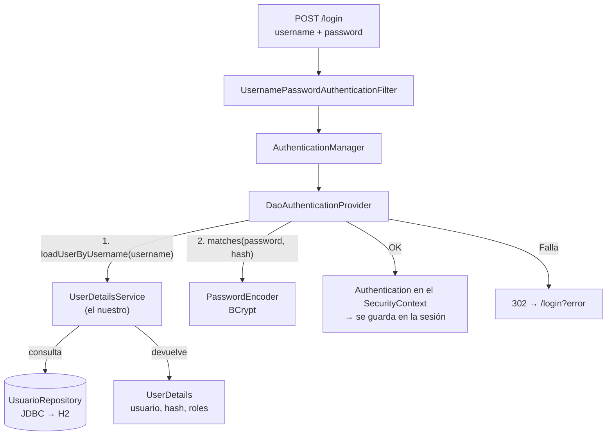

# Spring Security en una aplicación MVC

> UT02 · RA4 — Sesiones, autenticación y autorización
> Stack: Spring Boot 4.1 · Spring Security 7 · Thymeleaf · JDBC · H2

## Índice

1. [El problema: una aplicación sin seguridad](#1-el-problema-una-aplicación-sin-seguridad)
2. [Autenticación y autorización](#2-autenticación-y-autorización)
3. [401 y 403](#3-401-y-403)
4. [HTTP no tiene memoria: la sesión y `JSESSIONID`](#4-http-no-tiene-memoria-la-sesión-y-jsessionid)
5. [Contraseñas: hash, sal y BCrypt](#5-contraseñas-hash-sal-y-bcrypt)
6. [La cadena de filtros](#6-la-cadena-de-filtros)
7. [Las piezas de la autenticación](#7-las-piezas-de-la-autenticación)
8. [Roles, authorities y el prefijo `ROLE_`](#8-roles-authorities-y-el-prefijo-role_)
9. [CSRF](#9-csrf)
10. [Qué hace Spring Security nada más añadirlo](#10-qué-hace-spring-security-nada-más-añadirlo)
11. [Cuidado con lo que encuentres en internet: Spring Security 7](#11-cuidado-con-lo-que-encuentres-en-internet-spring-security-7)
12. [Resumen](#12-resumen)
13. [Preguntas de repaso](#13-preguntas-de-repaso)

---

## 1. El problema: una aplicación sin seguridad

En BibliotecaJDBC cualquiera que conozca la URL puede dar de alta, editar o borrar libros. No hace falta ni pulsar un botón: basta con escribir la dirección en el navegador o lanzar la petición con cualquier cliente HTTP.

Necesitamos responder a dos preguntas en **cada petición**:

1. **¿Quién eres?**
2. **¿Puedes hacer esto?**

Spring Security responde a las dos antes de que la petición llegue a nuestros controladores.

---

## 2. Autenticación y autorización

| | Autenticación | Autorización |
|---|---|---|
| Pregunta | ¿Quién eres? | ¿Qué puedes hacer? |
| Se comprueba con | Credenciales (usuario + contraseña) | Roles o permisos del usuario ya identificado |
| Cuándo | Una vez, al hacer login (luego se recuerda en la sesión) | En cada petición a un recurso protegido |
| Si falla | No sabemos quién eres → al login | Sabemos quién eres, pero no tienes permiso → error 403 |
| Ejemplo en la biblioteca | `ana` / `1234` es correcto | `ana` es USER: puede consultar, pero no borrar |

> **Orden:** primero autenticación, después autorización. No se puede decidir qué puede hacer alguien sin saber quién es.

Analogía: en un hotel, enseñar el DNI en recepción es **autenticarse**; que tu tarjeta abra tu habitación y no la del vecino es **autorización**.

---

## 3. 401 y 403

| Código | Nombre oficial | Significado real |
|---|---|---|
| **401** | Unauthorized | "No sé quién eres". Faltan credenciales o son incorrectas. (El nombre engaña: es un fallo de **autenticación**.) |
| **403** | Forbidden | "Sé quién eres y no puedes". Fallo de **autorización**. Volver a identificarse no cambia nada. |

### Matiz en una aplicación MVC con formulario de login

En una aplicación con navegador, un usuario no autenticado que pide una página protegida **no ve un 401**: Spring Security le **redirige (302) a `/login`**, que es más amable. Tras identificarse, lo devuelve a la página que había pedido.

El 401 "puro" lo verás en la **API REST** (UT03), donde no hay pantalla de login a la que redirigir.

| Situación | MVC (formulario) | API REST |
|---|---|---|
| No autenticado pide algo protegido | 302 → `/login` | 401 |
| Autenticado sin permiso | 403 (página de error) | 403 |

---

## 4. HTTP no tiene memoria: la sesión y `JSESSIONID`

HTTP es un protocolo **sin estado**: cada petición llega sola, sin recordar las anteriores. Si hacemos login en una petición, en la siguiente el servidor ya no sabría quién somos.

La solución en una aplicación MVC es la **sesión**:

1. El servidor crea un objeto `HttpSession` (en su memoria) y le asigna un identificador aleatorio.
2. Envía ese identificador al navegador en una cookie llamada `JSESSIONID`.
3. El navegador devuelve la cookie en cada petición.
4. Con ese identificador, el servidor recupera la sesión y, dentro de ella, **quién es el usuario**.



### Qué guarda Spring Security en la sesión

- El usuario autenticado se representa con un objeto `Authentication` (nombre, authorities, si está autenticado…).
- Ese objeto vive en el `SecurityContext`, y el `SecurityContext` se guarda en la `HttpSession`.
- En cada petición, Spring Security lo saca de la sesión y lo deja accesible en `SecurityContextHolder` mientras dura la petición.

### Detalles importantes

| Concepto | Qué hace Spring Security |
|---|---|
| **Fijación de sesión** | Al hacer login **cambia el identificador** de sesión. Si alguien consiguió que usaras un `JSESSIONID` conocido antes de entrar, deja de valerle. |
| **Logout** | Invalida la sesión y borra el contexto de seguridad. |
| **Caducidad** | Si no hay actividad, la sesión caduca (por defecto 30 minutos; propiedad `server.servlet.session.timeout`). |
| **Robo de la cookie** | Quien tenga tu `JSESSIONID` **es tú** para el servidor. Por eso en producción va siempre por HTTPS. |

> **Sesión vs token:** en la UT03 la API REST no usará sesión, sino un token JWT que el cliente envía en cada petición. Misma idea (recordar quién eres), distinto mecanismo.

---

## 5. Contraseñas: hash, sal y BCrypt

### Regla de oro

**Nunca se guarda la contraseña en la base de datos.** Ni en claro ni cifrada: se guarda su **hash**.

| | Cifrado | Hash |
|---|---|---|
| ¿Se puede volver atrás? | Sí, con la clave | No (función de un solo sentido) |
| Si roban la BD (y la clave) | Tienen todas las contraseñas | Solo tienen hashes |
| Para contraseñas | ❌ | ✅ |

¿Cómo se comprueba entonces el login? **Se calcula el hash de lo que escribe el usuario y se compara con el guardado.** Nunca se "descifra" nada.

### Por qué no basta con un hash cualquiera (MD5, SHA-256)

- Son **muy rápidos**: un atacante puede probar miles de millones de contraseñas por segundo.
- Misma contraseña → mismo hash: si dos usuarios usan `1234`, se nota, y existen tablas precalculadas (*rainbow tables*).

### La sal (*salt*)

Antes de calcular el hash se añade a la contraseña un valor **aleatorio distinto para cada usuario**, la sal. Resultado: la misma contraseña produce hashes distintos y las tablas precalculadas no sirven.

### BCrypt

Algoritmo de hash pensado para contraseñas:

- **Genera la sal automáticamente** y la guarda dentro del propio hash.
- Es **lento a propósito**, con un **factor de coste** configurable: cada +1 duplica el tiempo. Por defecto, 10.
- `PasswordEncoder` de Spring: `BCryptPasswordEncoder`.

Anatomía de un hash BCrypt (60 caracteres):

```
$2a$10$N9qo8uLOickgx2ZMRZoMyeIjZAgcfl7p92ldGxad68LJZdL17lhWy
 │  │  └──────── sal (22) ────────┘└──────── hash (31) ────────┘
 │  └ coste (10)
 └ versión del algoritmo
```

Los dos métodos que importan de `PasswordEncoder`:

```java
String hash = passwordEncoder.encode("1234");          // para guardar
boolean ok  = passwordEncoder.matches("1234", hash);   // para comprobar
```

> **Prueba en clase:** llama dos veces a `encode("1234")`. Salen dos hashes distintos y **los dos** dan `true` con `matches`. Por eso **nunca** se compara con `equals`: cada hash lleva su propia sal.

Consecuencias prácticas:

- La columna de la contraseña necesita al menos `VARCHAR(60)`.
- En los `INSERT` de `data.sql` se pone **el hash**, no la contraseña (lo generamos una vez con `encode` y lo copiamos).

> En tutoriales verás contraseñas como `{noop}1234` o `{bcrypt}$2a$10$...`. Ese prefijo entre llaves lo usa `DelegatingPasswordEncoder`, que admite varios algoritmos a la vez. Nosotros declaramos directamente un `BCryptPasswordEncoder`, así que **no** se pone prefijo.

---

## 6. La cadena de filtros

### Dónde actúa Spring Security

Spring Security **no** está en los controladores: está **antes**, en una cadena de **filtros** de servlet. La petición atraviesa los filtros y, solo si todos la dejan pasar, llega al `DispatcherServlet` y de ahí a nuestro controlador.



(Hay más filtros; estos son los que nos interesan.)

| Filtro | Qué hace |
|---|---|
| `SecurityContextHolderFilter` | Saca de la sesión al usuario autenticado (si lo hay). |
| `CsrfFilter` | En peticiones que modifican (POST, PUT, DELETE) exige un token CSRF válido. Si falta → 403. |
| `LogoutFilter` | Atiende `POST /logout`: invalida la sesión. |
| `UsernamePasswordAuthenticationFilter` | Atiende `POST /login`: lee `username` y `password` del formulario y lanza la autenticación. |
| `AnonymousAuthenticationFilter` | Si nadie se ha identificado, pone un usuario "anónimo". Así siempre hay alguien en el contexto. |
| `ExceptionTranslationFilter` | Captura los errores de seguridad: si el usuario es anónimo → redirige al login; si está autenticado y no tiene permiso → 403. |
| `AuthorizationFilter` | Aplica las reglas de `authorizeHttpRequests`: decide si esa URL se puede pedir. |

### `SecurityFilterChain`: la configuración

Nosotros no programamos filtros: **configuramos** la cadena con un bean `SecurityFilterChain` en una clase `@Configuration`. Cada bloque (lambda) configura uno o varios filtros:

```java
@Configuration
public class SecurityConfig {

    @Bean
    public SecurityFilterChain securityFilterChain(HttpSecurity http) throws Exception {
        http
            .authorizeHttpRequests(auth -> auth                 // → AuthorizationFilter
                .requestMatchers("/", "/login", "/css/**", "/js/**").permitAll()
                .anyRequest().authenticated()
            )
            .formLogin(form -> form                             // → UsernamePasswordAuthenticationFilter
                .loginPage("/login")
                .permitAll()
            )
            .logout(logout -> logout                            // → LogoutFilter
                .logoutSuccessUrl("/login?logout")
            );
        return http.build();
    }

    @Bean
    public PasswordEncoder passwordEncoder() {
        return new BCryptPasswordEncoder();
    }
}
```

> Esto es solo para ver la forma. En la práctica guiada lo construiremos paso a paso.

---

## 7. Las piezas de la autenticación

Qué ocurre cuando el usuario envía el formulario de login:



| Pieza | Qué es | ¿La escribimos? |
|---|---|---|
| `UserDetails` | Interfaz de Spring Security: "un usuario tal como lo entiende Spring" (username, password, authorities, activo…). | No: usamos la clase `User` que ya trae Spring Security. |
| `UserDetailsService` | Interfaz con un único método: `loadUserByUsername(String)`. Busca el usuario y lo devuelve como `UserDetails`. Si no existe, lanza `UsernameNotFoundException`. | **Sí**: es el puente entre nuestra BD y Spring Security. |
| `PasswordEncoder` | Calcula y compara hashes. | No: declaramos un bean `BCryptPasswordEncoder`. |
| `DaoAuthenticationProvider` | Usa los dos anteriores: carga el usuario y comprueba la contraseña. | No: Spring Boot lo configura solo si encuentra **un** `UserDetailsService` y **un** `PasswordEncoder`. |
| `AuthenticationManager` | Coordina a los *providers*. | No. |

> **No declares beans `AuthenticationProvider` ni `AuthenticationManager`** como verás en muchos tutoriales antiguos. Sobran, y el método `setUserDetailsService` que usaban ya no existe en Spring Security 7.

### Por qué nuestra clase `Usuario` no implementa `UserDetails`

Hay dos formas de conectar nuestros usuarios con Spring Security:

**Opción A: la entidad implementa `UserDetails`**

```java
public class Usuario implements UserDetails { ... }
```

**Opción B: un `UserDetailsService` traduce `Usuario` → `User`**

```java
return User.builder()
        .username(usuario.getUsername())
        .password(usuario.getPassword())
        .roles(usuario.getRol())
        .build();
```

| | A: `implements UserDetails` | B: `UserDetailsService` traduce |
|---|---|---|
| ✅ Ventaja | Menos código: la entidad ya es lo que Spring necesita | `Usuario` solo representa un usuario de la biblioteca |
| ✅ Ventaja | Es la forma más habitual en tutoriales y en el código que genera la IA | El modelo no depende de Spring Security |
| ❌ Inconveniente | `Usuario` tiene dos responsabilidades: ser un usuario y ser un usuario de Spring Security | Unas líneas más de código |
| ❌ Inconveniente | `model` se llena de métodos de Spring (`getAuthorities()`, `isEnabled()`…) | — |

**Este curso usamos la opción B** porque aplica **SRP** (responsabilidad única): cada clase tiene un único motivo para cambiar.

- Si cambian los datos del usuario → cambia `Usuario`.
- Si cambia la forma de autenticar → cambia el `UserDetailsService`.

El `UserDetailsService` actúa como **adaptador**: convierte nuestro objeto en el que espera Spring.

> La opción A no está mal y funciona. Si la encuentras en internet, la reconocerás. Pero no separa responsabilidades, y este curso vamos en serio con los patrones.
---

## 8. Roles, authorities y el prefijo `ROLE_`

Para Spring Security, un usuario tiene una lista de **authorities** (permisos): simples cadenas de texto. Un **rol** es una authority que, por convención, empieza por `ROLE_`.

| Escribes | Spring guarda / busca |
|---|---|
| `User.builder().roles("ADMIN")` | authority `ROLE_ADMIN` (añade el prefijo) |
| `User.builder().authorities("ROLE_ADMIN")` | authority `ROLE_ADMIN` (tal cual) |
| `.hasRole("ADMIN")` | busca `ROLE_ADMIN` (añade el prefijo) |
| `.hasAuthority("ROLE_ADMIN")` | busca `ROLE_ADMIN` (tal cual) |
| `sec:authorize="hasRole('ADMIN')"` | busca `ROLE_ADMIN` |

**Convención en clase:** en la base de datos guardamos el rol **sin prefijo** (`ADMIN`, `USER`) y usamos siempre `roles(...)` y `hasRole(...)`.

> Error típico: guardar `ROLE_ADMIN` en la BD y usar `roles(...)`. Spring lanza una excepción porque el valor ya empieza por `ROLE_`. Y si lo mezclas al revés (`authorities("ADMIN")` + `hasRole("ADMIN")`), nadie tiene permiso: busca `ROLE_ADMIN` y el usuario tiene `ADMIN`.

### Reglas de autorización: el orden importa

Las reglas de `authorizeHttpRequests` se evalúan **de arriba abajo** y gana **la primera que coincide**. Por tanto: de lo más concreto a lo más general, y `anyRequest()` siempre al final.

```java
.authorizeHttpRequests(auth -> auth
    .requestMatchers("/", "/login", "/css/**", "/js/**").permitAll()
    .requestMatchers("/libros/nuevo", "/libros/editar/**", "/libros/borrar/**").hasRole("ADMIN")
    .requestMatchers("/libros/**").hasAnyRole("ADMIN", "USER")
    .anyRequest().authenticated()
)
```

Si pusiéramos `/libros/**` en segundo lugar, un USER podría editar y borrar: la regla general taparía a la concreta.

| Método | Significado |
|---|---|
| `permitAll()` | Cualquiera, incluso sin login. |
| `authenticated()` | Cualquier usuario identificado. |
| `hasRole("X")` | Solo quien tenga el rol X. |
| `hasAnyRole("X", "Y")` | Quien tenga X o Y. |
| `denyAll()` | Nadie. |

### Ocultar un botón no es proteger

Con `sec:authorize` podemos ocultar en la vista el botón "Borrar" a quien no es ADMIN. Es **comodidad**, no seguridad: la URL sigue existiendo y cualquiera puede escribirla o enviarla con un cliente HTTP.

| Capa | Qué aporta |
|---|---|
| Vista (`sec:authorize`) | Experiencia de usuario: no enseñar lo que no puede usar. |
| `SecurityFilterChain` (`hasRole`) | **Seguridad real**: el servidor rechaza la petición con 403. |

Hacen falta **las dos**.

---

## 9. CSRF

### El ataque

**CSRF** (*Cross-Site Request Forgery*, falsificación de petición entre sitios):

1. Ana inicia sesión en la biblioteca. Su navegador guarda la cookie `JSESSIONID`.
2. Sin cerrar sesión, visita otra web (maliciosa).
3. Esa web contiene un formulario oculto que se envía solo a `http://biblioteca/libros/borrar/7`.
4. El navegador **adjunta automáticamente** la cookie de la biblioteca.
5. Para el servidor, la petición es de Ana, autenticada y con permiso. Libro borrado.

El problema: **la cookie viaja sola**. La sesión demuestra que el navegador es el de Ana, no que Ana quisiera hacer esa petición.

### La defensa: el token CSRF

- El servidor genera un **token aleatorio** asociado a la sesión.
- Lo incluye como campo oculto en **sus** formularios.
- En cada petición que modifica datos (POST, PUT, DELETE), el `CsrfFilter` exige que el token llegue y coincida. Si no → **403**.
- La web maliciosa no puede leer ese token (el navegador no le deja leer páginas de otro dominio), así que no puede falsificar la petición.

### En Thymeleaf es automático

Si el formulario usa `th:action`, Thymeleaf añade solo el campo oculto:

```html
<form th:action="@{/libros/nuevo}" method="post">
    <!-- Thymeleaf genera: -->
    <!-- <input type="hidden" name="_csrf" value="4bfd1575-..."/> -->
</form>
```

> Si escribes `action="/libros/nuevo"` (sin `th:`), **no** se añade el token y el envío dará 403.

### Consecuencias en nuestro proyecto

| Regla | Motivo |
|---|---|
| CSRF **activado** (es el valor por defecto; no lo desactives). | Nuestra aplicación usa sesión con cookie: es justo el caso vulnerable. |
| **Logout por POST**, con un formulario (no un enlace). | Si fuera GET, cualquier web podría cerrarte la sesión con un simple ``. |
| **Nada que modifique datos por GET** (borrar con un enlace `<a href>`, por ejemplo). | CSRF solo protege POST, PUT y DELETE. Un borrado por GET queda **sin protección**. |

> En la API REST con JWT (UT03) se desactiva CSRF, y tiene sentido: el token no viaja solo en una cookie, lo añade el cliente a mano en cada petición.

---

## 10. Qué hace Spring Security nada más añadirlo

Solo con añadir la dependencia `spring-boot-starter-security`, sin escribir ni una línea:

| Comportamiento | Detalle |
|---|---|
| **Todo** queda protegido | Cualquier URL exige login, incluidos los CSS e imágenes. |
| Formulario de login generado | En `/login`, con un diseño propio de Spring. |
| Logout | En `/logout` (con página de confirmación). |
| Un usuario de prueba | Nombre `user`; la contraseña aleatoria aparece en la consola al arrancar (`Using generated security password: ...`). Cambia en cada arranque. |
| CSRF activado | Los formularios sin token dan 403. |
| Cabeceras de seguridad | Entre otras, impide mostrar la aplicación dentro de un `<iframe>` (esto afecta a la consola de H2, lo veremos en la práctica). |

A partir de ahí, nuestro trabajo es **abrir** lo que deba ser público y **definir** quién puede hacer qué.

---

## 11. Cuidado con lo que encuentres en internet: Spring Security 7

Spring Security 7 (incluido en Spring Boot 4) **eliminó** muchas formas antiguas de configurar. La mayoría de tutoriales, respuestas de foros y bastante código generado por IA siguen usándolas y **no compilan**.

| Verás en internet | En Spring Security 7 |
|---|---|
| `extends WebSecurityConfigurerAdapter` + `configure(HttpSecurity)` | Eliminado (desde la 6). Se declara un bean `SecurityFilterChain`. |
| `.authorizeRequests()` | Eliminado. `.authorizeHttpRequests(...)` |
| `.antMatchers(...)`, `.mvcMatchers(...)` | Eliminados. `.requestMatchers(...)` |
| Encadenar con `.and()` | Eliminado. Cada bloque con su lambda. |
| `@EnableGlobalMethodSecurity` | Eliminado. `@EnableMethodSecurity` |
| `provider.setUserDetailsService(...)` | Eliminado. Y además no hace falta declarar el *provider*. |
| `{noop}1234` en contraseñas | Funciona, pero solo para pruebas. Nosotros, BCrypt. |

> Si un código usa alguno de los de la izquierda, está escrito para una versión antigua: **desconfía del resto también**.

---

## 12. Resumen

| Concepto | En una frase |
|---|---|
| Autenticación | Comprobar quién eres (login). |
| Autorización | Comprobar si puedes hacer algo (roles). |
| 401 / 403 | No sé quién eres / sé quién eres y no puedes. En MVC, el "401" se convierte en redirección al login. |
| Sesión | El servidor recuerda al usuario autenticado; el navegador lo identifica con la cookie `JSESSIONID`. |
| Hash | Función de un solo sentido: se guarda el hash, nunca la contraseña. |
| BCrypt | Hash lento, con sal aleatoria incluida y coste configurable. Se compara con `matches`, nunca con `equals`. |
| Cadena de filtros | Spring Security actúa antes que los controladores, en filtros configurados con `SecurityFilterChain`. |
| `UserDetailsService` | Nuestro adaptador: busca el usuario en la BD y lo entrega a Spring como `UserDetails`. |
| `ROLE_` | `hasRole("ADMIN")` busca la authority `ROLE_ADMIN`. En BD guardamos `ADMIN` y usamos `roles(...)`. |
| Orden de reglas | Gana la primera que coincide: de lo concreto a lo general, `anyRequest()` al final. |
| `sec:authorize` | Oculta en la vista; no protege. La protección está en el servidor. |
| CSRF | Token oculto en los formularios que impide que otra web actúe con tu sesión. Activado; logout por POST; nada que modifique por GET. |

---

## 13. Preguntas de repaso

1. Un usuario con rol USER intenta borrar un libro. ¿Qué falla, la autenticación o la autorización? ¿Qué código HTTP recibe?
2. Un usuario sin identificar pide `/libros`. ¿Ve un 401? ¿Por qué?
3. Ejecutas dos veces `passwordEncoder.encode("1234")` y obtienes resultados distintos. ¿Es un error? ¿Cómo se comprueba entonces la contraseña en el login?
4. ¿Por qué no basta con guardar el SHA-256 de la contraseña?
5. En la BD el rol está guardado como `ROLE_ADMIN` y en el `UserDetailsService` usas `.roles(rol)`. ¿Qué pasa?
6. Tienes estas reglas en este orden: `requestMatchers("/libros/**").authenticated()` y después `requestMatchers("/libros/borrar/**").hasRole("ADMIN")`. ¿Puede borrar un USER? ¿Cómo lo arreglas?
7. Has ocultado el botón "Borrar" con `sec:authorize`. ¿Está protegido el borrado?
8. Un formulario con `action="/libros/nuevo"` devuelve 403 al enviarlo, aunque el usuario es ADMIN. ¿Qué ocurre?
9. ¿Por qué el logout debe hacerse por POST?
10. Encuentras un ejemplo con `extends WebSecurityConfigurerAdapter` y `.antMatchers(...)`. ¿Te sirve para nuestro proyecto?
