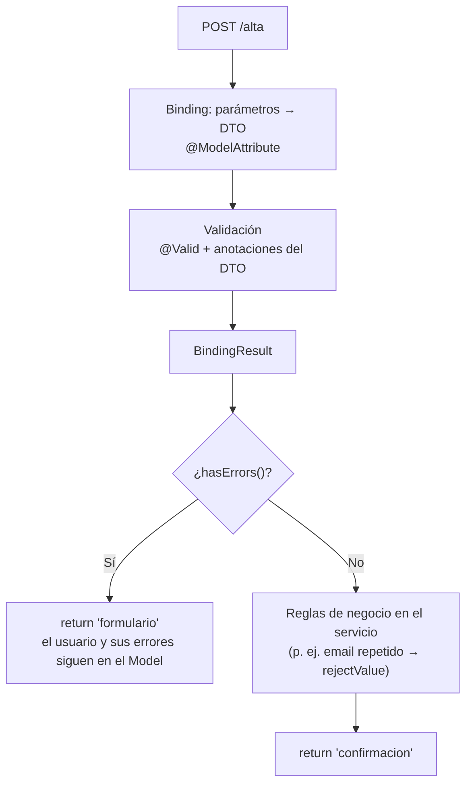

# Ejercicio 1 (v2). Alta de usuario con validación e internacionalización

> Continuación de [Ejercicio 1. Alta de usuario: de Servlet/JSP a Spring MVC](./alta-usuario-spring.md).
> **Misma aplicación, mejor diseñada:** los cuatro `@RequestParam` pasan a ser **un objeto**, la validación "a mano" pasa a ser **declarativa** y los textos salen de **ficheros de mensajes**.
> El código lo construimos en clase. Aquí está el **mapa** de los elementos nuevos.

## Qué cambia respecto a la versión 1

| Necesidad | v1 (`@RequestParam`) | v2 (objeto de formulario) |
|---|---|---|
| Recoger datos | 4 parámetros sueltos | 1 objeto: **DTO** (clase con Lombok) + `@ModelAttribute` |
| Validar | `if (nombre.isBlank())` en el controlador | Anotaciones en el DTO (`@NotBlank`, `@Email`…) + `@Valid` |
| Saber si hay errores | Variable `mensajeError` puesta a mano | `BindingResult` (lo rellena Spring) |
| Mostrar errores | Un único mensaje para todo el formulario | Un mensaje **por campo**: `th:errors` |
| Conservar lo escrito | `th:value` / `th:selected` / `#lists.contains` campo a campo | `th:object` + `th:field` (automático) |
| Cargar las listas | Repetido en el GET y en el POST con error | Método `@ModelAttribute` (una sola vez) |
| Textos de los mensajes | Escritos en el código Java / HTML | `messages.properties`: `{clave}` en las anotaciones, `#{clave}` en la vista |

---

## 1. Nuevos ficheros y dependencias

**Dependencias nuevas:** `spring-boot-starter-validation` (en Initializr: **Validation**), que trae Jakarta Bean Validation + Hibernate Validator, y **Lombok**.


---

## 2. DTO: clase con Lombok (no `record`)

**DTO** (*Data Transfer Object*): objeto que solo transporta datos entre capas. Aquí, entre el formulario HTML y el controlador.

```java
@Data                 // getters, setters, toString, equals, hashCode
@NoArgsConstructor    // constructor vacío: new UsuarioAltaDto() para el GET
@AllArgsConstructor   // (opcional) constructor con todo, útil en tests
public class UsuarioAltaDto {
    @NotBlank private String nombre;
    ...
    private List<String> niveles = new ArrayList<>();
}
```

| Característica | Por qué encaja con un formulario MPA |
|---|---|
| Constructor vacío | En el GET basta con `new UsuarioAltaDto()` para que `th:object` pinte el formulario vacío |
| Setters | Spring rellena el objeto campo a campo (*setter binding*). El controlador puede modificarlo antes de volver a la vista (valores por defecto, borrar la contraseña…) |
| Valores iniciales | `niveles = new ArrayList<>()`: nunca es `null` en la vista |
| Las anotaciones de validación van sobre los atributos | El DTO describe **qué datos son válidos** |
| No es una entidad de BD | Cuando llegue JPA, la entidad será otra clase. El formulario no tiene por qué coincidir con la tabla |

> **Lombok en IntelliJ:** plugin activo y *Settings → Build → Compiler → Annotation Processors → Enable annotation processing*.

### ¿`record` o clase?

| | `record` | Clase + Lombok |
|---|---|---|
| Mutabilidad | Inmutable | Mutable |
| Cómo lo crea Spring | Por **constructor** (*constructor binding*) | Constructor vacío + **setters** |
| Objeto vacío para el GET | `new UsuarioAltaDto(null, null, null, List.of())` | `new UsuarioAltaDto()` |
| Modificar un campo | Crear otro objeto | `setX(...)` |
| Dónde encaja mejor | **API REST** (UD3): JSON → objeto → respuesta, sin ida y vuelta | **Formularios MPA**: el objeto va y vuelve entre vista y controlador |

> Un `record` **también funciona** con `@ModelAttribute` y Thymeleaf. Elegimos la clase porque el formulario es un objeto que va y vuelve y se rellena por partes, y eso es más natural con un objeto mutable.

> **Ojo:** el `name` del `<select multiple>` pasa de `nivel` (v1) a `niveles`: debe llamarse igual que el atributo del DTO. `th:field` lo genera solo.

---

## 3. Bean Validation: anotaciones

Paquete `jakarta.validation.constraints`.

| Anotación | Se aplica a | Comprueba | Uso en el alta |
|---|---|---|---|
| `@NotNull` | Cualquier tipo | No es `null` | — |
| `@NotEmpty` | String, colecciones | No es `null` ni vacío | `niveles`: al menos uno |
| `@NotBlank` | String | No es `null`, vacío ni solo espacios | `nombre`, `email`, `tecnologia` |
| `@Size(min, max)` | String, colecciones | Longitud / tamaño | `nombre`: 2 a 50 caracteres |
| `@Email` | String | Formato de email | `email` |
| `@Pattern(regexp)` | String | Expresión regular | (reto: teléfono, DNI…) |
| `@Min` / `@Max` / `@Positive` | Números | Rango | (si añadimos edad) |
| `@Past` / `@Future` | Fechas | Antes / después de hoy | (si añadimos fecha de nacimiento) |

- Todas aceptan `message = "..."` o `message = "{clave}"` (ver apartado 7).
- Sin `message`, Hibernate Validator ya trae mensajes **traducidos** al idioma de la petición (*"no debe estar vacío"*, *"must not be blank"*).
- El atributo `required` de HTML5 sigue siendo útil para el usuario, pero **no protege**: la validación de verdad es la del servidor.

---

## 4. `@ModelAttribute`: dos usos distintos

### a) En un **parámetro**: "construye este objeto con los datos de la petición"

| Paso | Quién lo hace |
|---|---|
| 1. Lee todos los parámetros (`nombre`, `email`, `niveles`…) | DispatcherServlet |
| 2. Convierte tipos (`String` → `List<String>`, `int`…) | Spring (*data binding*) |
| 3. Crea el DTO con el constructor vacío y llama a los setters | Spring |
| 4. Mete el objeto en el `Model` con ese nombre | Spring |

- `@ModelAttribute("usuario") UsuarioAltaDto usuario` → en la vista está disponible como `${usuario}`.
- Sin nombre, se usa el del tipo en minúscula (`usuarioAltaDto`). Mejor ponerlo explícito: tiene que coincidir con el `th:object`.
- En el **GET** también hace falta un objeto (vacío) en el modelo, porque `th:object` lo necesita para pintar el formulario.

### b) En un **método**: "ejecuta esto antes de cada petición de este controlador"

- `@ModelAttribute("tecnologias")` sobre un método que devuelve la lista → la lista está en el modelo en **todas** las vistas del controlador.
- Sustituye al método `cargarListas(model)` que llamábamos en el GET **y** en el POST con error.

---

## 5. `@Valid` + `BindingResult`

| Elemento | Qué es |
|---|---|
| `@Valid` | Delante del parámetro `@ModelAttribute`: pide a Spring que **valide** el objeto con sus anotaciones |
| `BindingResult` | Resultado del *binding* y de la validación: errores por campo y errores globales |
| `bindingResult.hasErrors()` | `true` si hay al menos un error → volver al formulario |
| `bindingResult.rejectValue("email", "clave")` | Añadir **a mano** un error a un campo (regla de negocio) |
| `bindingResult.reject("clave")` | Añadir un error **global** (no asociado a un campo) |

**Regla de oro:** `BindingResult` va **justo después** del parámetro que valida.

```java
procesar(@Valid @ModelAttribute("usuario") UsuarioAltaDto usuario,
         BindingResult bindingResult, Model model)
```

Si no está, o no va justo detrás, un error de validación no llega al método: Spring lanza `MethodArgumentNotValidException` y responde con un **400**.



**Validación de formato vs. regla de negocio:**

| Tipo | Ejemplo | Dónde va |
|---|---|---|
| Formato / obligatoriedad | Email con formato válido | Anotación en el DTO |
| Negocio | Ese email ya está dado de alta | Servicio → el controlador lo traduce a `rejectValue` |


Ejemplo de rejectValue:
```java
        // Validación "a mano"
        // En la vista se muestra con th:errors="*{nombre}". Próximas sesiones: @NotBlank + @Valid.
        if (usuario.getNombre() == null || usuario.getNombre().isBlank()) {
            bindingResult.rejectValue("nombre", "obligatorio", "El nombre es obligatorio");
        }
```

```html
<!-- Error asociado al campo "nombre" (bindingResult.rejectValue("nombre", ...)).
             Sustituye al mensajeError genérico de formulario.html -->
        <div class="error-msg" th:if="${#fields.hasErrors('nombre')}" th:errors="*{nombre}">Error en el nombre</div>
```


---

## 6. Thymeleaf para formularios

| Elemento | Dónde | Qué hace |
|---|---|---|
| `th:object="${usuario}"` | `<form>` | Indica el objeto del formulario |
| `th:field="*{nombre}"` | `<input>`, `<select>`, `<textarea>` | Genera `id`, `name` y `value` (y `selected`/`checked`) **a la vez** |
| `#fields.hasErrors('nombre')` | `th:if` | `true` si ese campo tiene error |
| `th:errors="*{nombre}"` | `<span>`, `<p>` | Pinta los mensajes de error de ese campo |
| `th:errorclass="campo-error"` | Input | Añade esa clase CSS solo si el campo tiene error |
| `#fields.hasGlobalErrors()` / `#fields.globalErrors()` | Cabecera del form | Errores globales (los de `reject`) |

**Lo que desaparece respecto a la v1:**

| v1 | v2 |
|---|---|
| `id="nombre" name="nombre" th:value="${nombre}"` | `th:field="*{nombre}"` |
| `th:selected="${t == tecnologia}"` | Lo hace `th:field` del `<select>` |
| `th:selected="${... #lists.contains(nivelesSeleccionados, n)}"` | Lo hace `th:field` del `<select multiple>` |
| `<div th:if="${mensajeError}">` (un mensaje para todo) | `th:errors` junto a cada campo |

---

## 7. Mensajes en `messages.properties` (introducción a i18n)

Los textos de los mensajes **salen del código** y se guardan en `src/main/resources/messages.properties`. Spring Boot lo detecta y lo configura solo: no hay que crear ninguna clase ni bean.

| Dónde | Sintaxis | Ejemplo |
|---|---|---|
| `messages.properties` | `clave=texto` | `usuario.nombre.obligatorio=El nombre es obligatorio` |
| Con atributos de la anotación | `{min}`, `{max}` en el texto | `usuario.nombre.size=Entre {min} y {max} caracteres` |
| Anotación de validación | `message = "{clave}"` | `@NotBlank(message = "{usuario.nombre.obligatorio}")` |
| `rejectValue` | 2º parámetro = clave | `bindingResult.rejectValue("email", "usuario.email.repetido")` |
| Thymeleaf (textos de la vista) | `#{clave}` | `th:text="#{alta.titulo}"` |

### ¿Por qué no escribir el texto directamente?

| `message = "El nombre es obligatorio"` | `message = "{usuario.nombre.obligatorio}"` |
|---|---|
| Texto mezclado con el código Java | Todos los textos en un único fichero |
| Cambiar un texto obliga a recompilar | Se cambia el `.properties` |
| Un solo idioma | Para tener inglés basta con añadir `messages_en.properties` con **las mismas claves** |

> **Idiomas:** Spring elige el fichero según el idioma del navegador (cabecera `Accept-Language`). Si existe `messages_en.properties` y el navegador está en inglés, los mensajes salen en inglés sin tocar código. El cambio de idioma con un selector en la página queda fuera de esta práctica.

### Avisos

- **Codificación:** Spring Boot lee los `messages*.properties` en UTF-8. Configurad IntelliJ para guardar los `.properties` en UTF-8 (*Settings → Editor → File Encodings*). Si no, las tildes salen como `á` o el build falla con `MalformedInputException`.
- **Clave que no existe:** en la vista se ve `??alta.titulo_es_ES??`. En una anotación se ve el texto literal `{usuario.nombre.obligatorio}`.

---

## 8. Requisitos de la v2

1. El formulario trabaja con un DTO (clase con Lombok) y un único `@ModelAttribute`.
2. Validaciones:
   - `nombre`: obligatorio, entre 2 y 50 caracteres.
   - `email`: obligatorio y con formato válido.
   - `tecnologia`: obligatoria.
   - `niveles`: al menos uno.
3. Cada error aparece **junto a su campo**, y el campo se marca en rojo (`th:errorclass`).
4. Al volver con errores **no se pierde nada** de lo escrito ni de lo seleccionado.
5. Las listas se cargan con métodos `@ModelAttribute` (ni una llamada a `cargarListas`).
6. Los mensajes de error de validación salen de `messages.properties` (ninguno escrito en el código Java).

---


[← Volver a la versión 1](./alta-usuario-spring.md)
