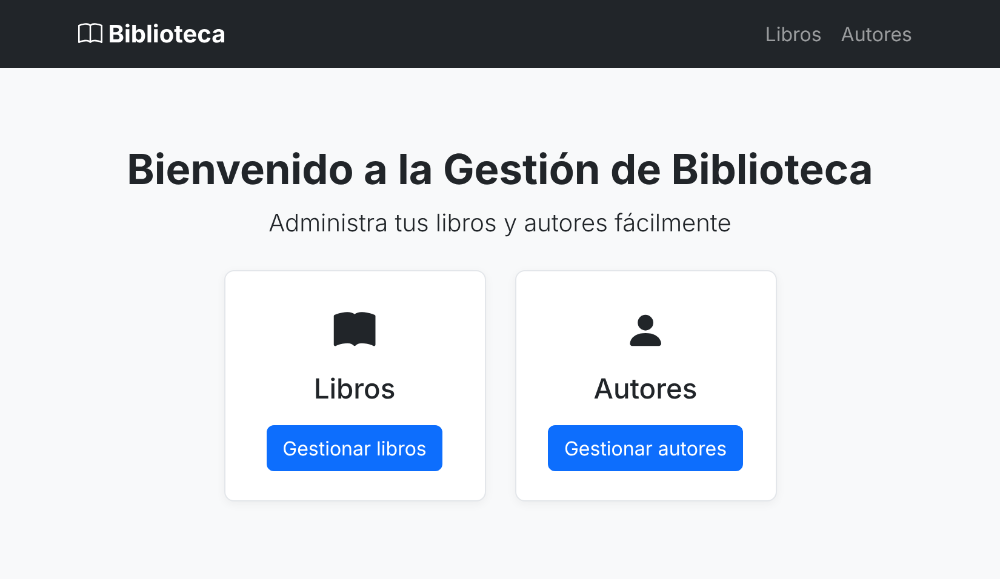
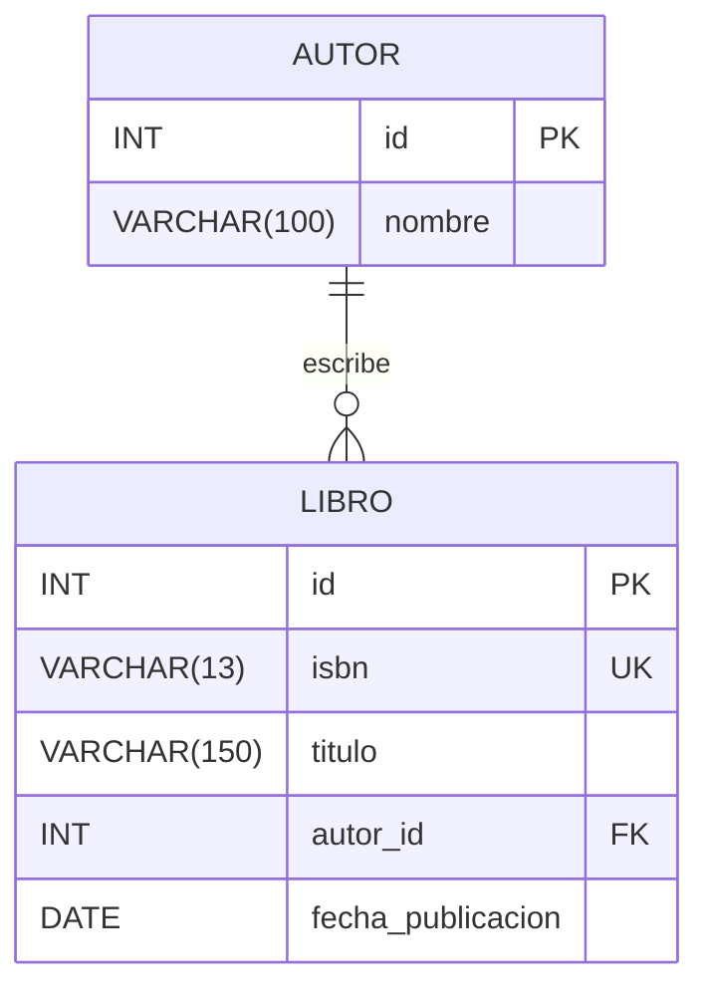
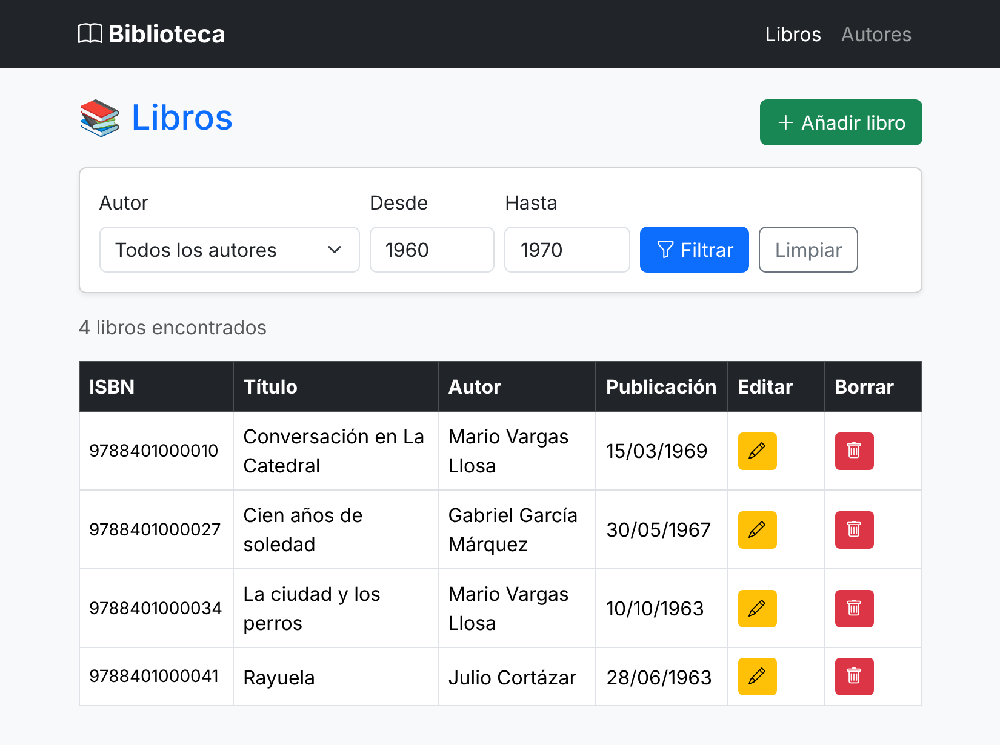
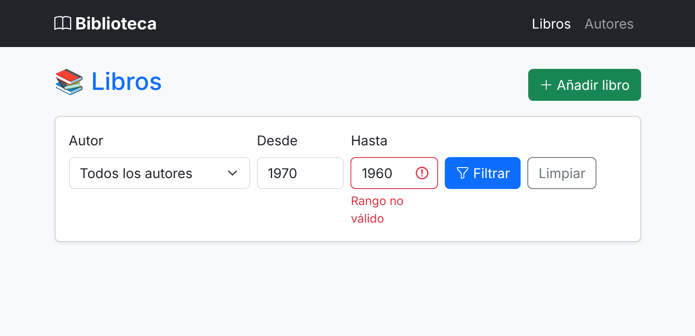
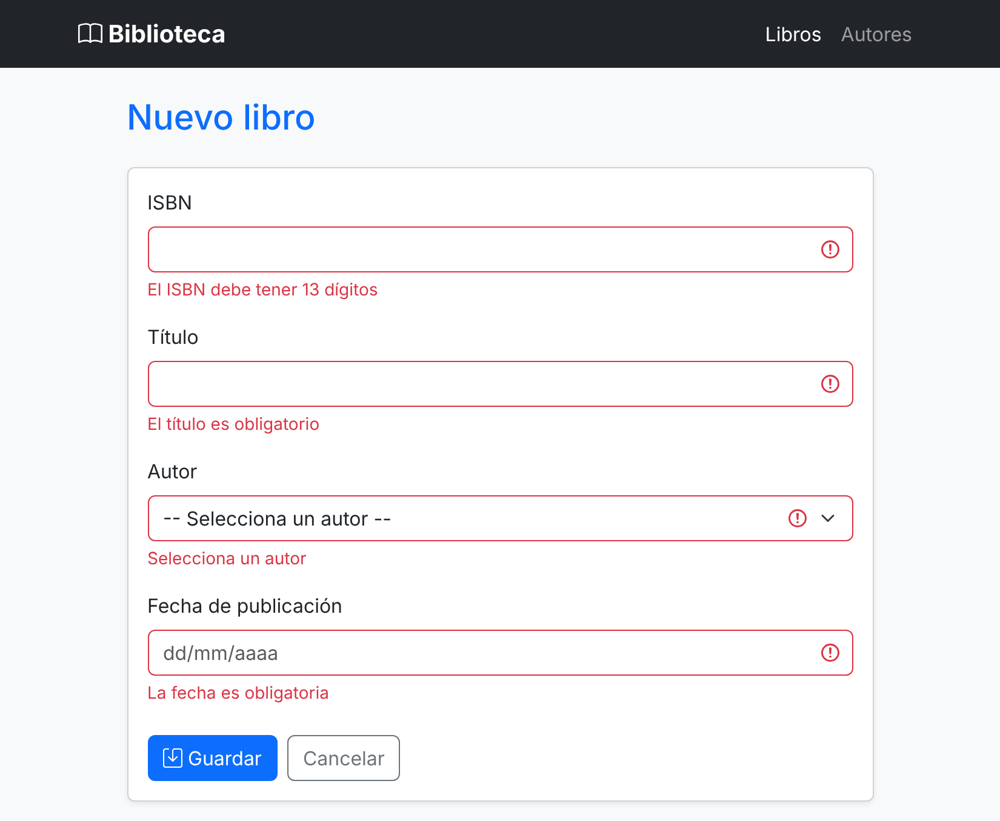
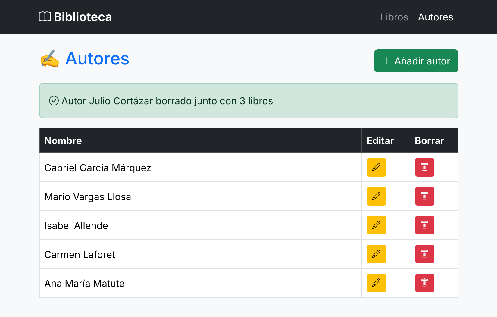

# Ejercicio de ampliación: BibliotecaApp con Spring y JDBC (autónomo)



> Esta vez **no hay solución guiada ni código que copiar**. Montáis el proyecto vosotros, desde cero, con apoyo de la IA.

---

## Contexto

Vais a desarrollar **BibliotecaApp**, una aplicación web que gestiona el catálogo de una biblioteca: **autores** y **libros** (con fecha de publicación). Permite listar, crear, actualizar, borrar y filtrar. La arquitectura es la de LogísticaApp: `@Controller` → `@Service` → `Repository` (interfaz) → `RepositoryJdbc` → H2.

Hay cosas nuevas:

| | LogísticaApp | BibliotecaApp | Qué aprendéis |
|---|---|---|---|
| **Borrar el padre** | Prohibido si tiene hijos (lo impide el servicio) | Se borran también sus libros (`ON DELETE CASCADE`) | La misma relación 1:N admite reglas opuestas. Quién hace cada trabajo: BD o Java |
| **Tipo de dato** |  | `DATE` ↔ `LocalDate` | Recorrer una fecha por todas las capas: BD, JDBC, formulario y vista |
| **Identificador** | `codigo`, interno y visible a la vez (id autoincrement) | `id` interno autoincrement que el usuario nunca ve + `isbn` público y único | Distinguir la clave técnica de la clave de negocio |
| **Consulta** | SQL fijo | SQL dinámico según los filtros rellenos | Montar el SQL en tiempo de ejecución **sin concatenar valores** |

## Cómo se usa la IA en este ejercicio

**En el examen no hay internet.** La IA os sirve hoy para aprender, no para sustituir lo que tendréis que saber hacer solos.

| Parte | Quién la hace | Vuestra responsabilidad |
|---|---|---|
| `schema.sql` y `data.sql` | IA | Revisar la FK, el `ON DELETE CASCADE` y los datos |
| HTML y CSS | IA | No importa el diseño de la vista |
| Modelo, repositorios, servicios, controladores, DTO, excepciones | **Vosotros** | La IA explica, da pistas y ayuda con los errores, pero no os escribe la clase |

> **Recordad:** código que funciona pero no sigue los patrones de clase no vale.

---

## Qué vais a construir

| URL | Método | Qué hace |
|---|---|---|
| `/` | GET | Portada (sin controlador: `WebConfig`) |
| `/libros` | GET | Listado con filtros opcionales: `?autorId=2&anioDesde=1960&anioHasta=1970` |
| `/libros/nuevo` | GET | Formulario vacío, con `<select>` de autores |
| `/libros/editar/{isbn}` | GET | Formulario relleno |
| `/libros/guardar` | POST | Alta o modificación |
| `/libros/borrar/{isbn}` | POST | Borrado con confirmación |
| `/autores` | GET | Listado de autores |
| `/autores/nuevo` | GET | Formulario vacío |
| `/autores/editar/{id}` | GET | Formulario relleno |
| `/autores/guardar` | POST | Alta o modificación |
| `/autores/borrar/{id}` | POST | Borra el autor **y sus libros**, con confirmación |
| `/h2-console` | GET | Consola de la base de datos |

## Modelo de datos

Un libro está escrito por un único autor. Un autor puede tener muchos libros.



Todas las columnas son obligatorias. Una FK no puede obligar a que un autor tenga libros, y además hay que dar de alta al autor **antes** que sus libros. Por eso puede existir un autor con cero libros.

| Clave | Para qué | Quién la ve |
|---|---|---|
| `id` | Clave técnica: autoincremental, PK y destino de la FK | Nadie. No aparece en ninguna tabla ni formulario |
| `isbn` | Clave de negocio del libro: ISBN-13, 13 dígitos sin guiones, `UNIQUE` | El usuario. Identifica al libro en pantalla y en las URL |

El ISBN se guarda como texto: no se opera con él y 13 dígitos no caben en un `INT`. Los autores no tienen clave de negocio, así que su `id` solo viaja donde es imprescindible (URL de edición y borrado, `value` del `<select>`), sin mostrarse nunca como dato.

---

## Así queda la aplicación

No hace falta que sea idéntica. Las imágenes son orientativas y los datos, de ejemplo.

| # | Vista | URL |
|---|---|---|
| 1 | Portada | `/` |
| 2 | Listado filtrado | `/libros?anioDesde=1960&anioHasta=1970` |
| 3 | Filtro con rango no válido | `/libros?anioDesde=1970&anioHasta=1960` |
| 4 | Alta con errores de validación | `/libros/nuevo` → Guardar |
| 5 | Autor borrado en cascada | `/autores` |

### Listado filtrado



### Filtro con rango no válido

Con errores en el filtro **no** se muestra la tabla.



### Alta con errores de validación



### Autor borrado en cascada



---

## Hito 0. Crear el proyecto

Montad el proyecto con lo trabajado en clase, con una base de datos H2 en memoria llamada `bibliotecadb`.

### ✅ Comprobación

La aplicación arranca y `/h2-console` conecta a `bibliotecadb`.

---

## Hito 1. Base de datos (con IA)

Generad `schema.sql` y `data.sql` a partir del [modelo de datos](#modelo-de-datos).

| Fichero | Requisitos |
|---|---|
| `schema.sql` | `DROP TABLE IF EXISTS` en el orden correcto. FK con nombre y `ON DELETE CASCADE`. `isbn` con `UNIQUE` |
| `data.sql` | Al menos 6 autores y 15 libros, con tildes y eñes. Un autor sin libros. Al menos 4 libros de 1960 a 1970, uno de ellos de 1960 y otro de 1970, y varios fuera de ese rango |

La IA puede **inventarse fechas e ISBN**. Para la práctica da igual, pero comprobad un par y tomad la costumbre.


---

## Hito 2. Modelo, interfaces y excepciones

Reutilizad el diseño de LogísticaApp, pero escribidlo vosotros, sin copiar y pegar.

| Paquete | Clases | Qué tener en cuenta |
|---|---|---|
| `model` | `Autor`, `Libro` | POJO sin anotaciones de persistencia. `Libro` guarda su `id`, su `isbn` y un objeto `Autor`, no un `autorId`. La fecha es `LocalDate` |
| `repository` | `GenericRepository<T, ID>`, `AutorRepository`, `LibroRepository` | Sin `SQLException` en las interfaces |
| `exception` | `AccesoDatosException`, `RecursoNoEncontradoException`, `IsbnDuplicadoException`, `GlobalExceptionHandler` | **No** hay equivalente a `FabricanteConProductosException`. ¿Por qué? |

`LibroRepository` añade al CRUD estas tres operaciones:

```java
Optional<Libro> findByIsbn(String isbn);

int countByAutorId(Integer autorId);

/** Cada parámetro es opcional: si llega null, ese filtro no se aplica. */
List<Libro> buscar(Integer autorId, Integer anioDesde, Integer anioHasta);
```

---

## Hito 3. Repositorios JDBC

Mismas reglas que en LogísticaApp: `PreparedStatement`, `try-with-resources`, `Optional` en `findById`, `RETURN_GENERATED_KEYS` en `save` y toda `SQLException` convertida en `AccesoDatosException`.

Dejad `buscar` para el hito 8. Por ahora, implementad el resto.

**Lo nuevo es la fecha:**

| Operación | Pista |
|---|---|
| Escribir | `ps.setObject(n, libro.getFechaPublicacion())` |
| Leer | `rs.getObject("fecha_publicacion", LocalDate.class)` |

Las dos tablas tienen `id`, así que necesitaréis alias en el `SELECT`, igual que en LogísticaApp. `update` y `delete` siguen trabajando por `id`, que es la clave primaria: el ISBN se queda en la capa de arriba.

---

## Hito 4. Servicios

| Servicio | Regla |
|---|---|
| `LibroService.buscarPorIsbn` | Si no existe, `RecursoNoEncontradoException` |
| `LibroService.crear` | Si el ISBN ya existe, `IsbnDuplicadoException`. Si el autor no existe, `RecursoNoEncontradoException`. El título se guarda sin espacios sobrantes |
| `LibroService.actualizar` y `borrar` | Reciben datos con ISBN y **sin `id`**: localizan el libro por ISBN y usan su `id` para llamar al repositorio. El ISBN no se modifica |
| `AutorService` | Si el autor no existe, `RecursoNoEncontradoException`. El nombre se guarda sin espacios sobrantes |
| `AutorService.borrar` | Cuenta los libros, borra el autor y **devuelve cuántos libros tenía**, para el mensaje de confirmación |

> **Importante:** el servicio **no** borra los libros uno a uno. De eso se encarga la base de datos. Si la IA os propone un bucle o un `DELETE FROM libro`, no ha entendido el `ON DELETE CASCADE`.

---

## Hito 5. Plantilla común, portada y errores (con IA)

Partiendo de vuestro `layout.html` y `estilos.css`, generad los fragmentos `head`, `navbar`, `alertas` y `scripts` para Biblioteca, junto con `index.html` y `error.html`.

---

## Hito 6. CRUD de autores

Primero los autores: sin ellos no hay `<select>` en el formulario de libros.

Escribid `AutorController`. Las vistas `autores/lista.html` y `autores/formulario.html` pueden salir de la IA, siempre con **vuestro controlador y vuestro modelo** como referencia, para que use los mismos nombres.

Requisitos de las vistas:

- `th:object`, `th:field`, `th:errors` y errores con Bootstrap, como en LogísticaApp.
- La tabla no muestra el `id`.
- El borrado es un `<form method="post">` con `confirm()` que avisa de que también se borrarán los libros del autor. Comprobad en /h2-console que no quedan libros de ese autor.

---

## Hito 7. CRUD de libros

Un formulario único para alta y edición, con `LibroForm` (clase con Lombok) en el paquete `dto`.

| Campo | Tipo | Validación |
|---|---|---|
| `isbn` | `String` | Obligatorio. Exactamente 13 dígitos (`@Pattern`) |
| `edicion` | `boolean` | Campo oculto: `false` = alta, `true` = edición |
| `titulo` | `String` | Obligatorio. Máximo 150 caracteres |
| `autorId` | `Integer` | Obligatorio |
| `fechaPublicacion` | `LocalDate` | Obligatoria. No puede ser futura (`@PastOrPresent`) |

`LibroForm` **no lleva `id`**: ni el formulario ni la URL lo publican.

Requisitos:

- El ISBN se escribe en el alta. En la edición se muestra `readonly`, porque no se puede cambiar.
- Si el ISBN ya existe, el error aparece junto a su campo, sin perder los datos: el controlador captura `IsbnDuplicadoException` y la traduce a `rejectValue`.
- Los mensajes de error salen de `messages.properties`, como en [Alta de usuario v2](./alta-usuario-spring-validacion.md).
- La lista del `<select>` se carga con un método `@ModelAttribute("autores")`. Así no se pierde al volver con errores.
- El formulario usa `<input type="date">`.
- El listado muestra la fecha como `dd/MM/yyyy`, con `#temporals.format(...)`.

> **Pista:** el navegador envía la fecha como `2026-11-03`. Si Spring no sabe convertirla, añadid `@DateTimeFormat(iso = DateTimeFormat.ISO.DATE)` al campo.


---

## Hito 8. Filtro de libros

`GET /libros` muestra el formulario de filtros y la tabla en la misma vista. Es el mismo planteamiento que los [Personajes de Springfield](./simpsons-spring.md), pero ahora el filtro lo resuelve **el SQL**, no un stream.

| Campo de `FiltroLibrosDto` | Tipo | Validación |
|---|---|---|
| `autorId` | `Integer` | Opcional |
| `anioDesde` | `Integer` | Opcional. Entre 1000 y 2100 |
| `anioHasta` | `Integer` | Opcional. Entre 1000 y 2100. No puede ser menor que `anioDesde` |

Requisitos:

- El formulario va por **GET** y conserva los valores tras buscar.
- Resultados ordenados por fecha, del más reciente al más antiguo.
- Se muestra cuántos libros se han encontrado o, si no hay ninguno, un mensaje en lugar de la tabla vacía.
- Con errores de validación, no se muestra la tabla.
- `anioHasta < anioDesde` se comprueba en el controlador y se añade con `rejectValue`.
- Enlace **Limpiar** que vuelve a `/libros`.

**Pista para `buscar`.** Son ocho combinaciones de filtros y no vais a escribir ocho consultas...

---

## ✅ Pruebas de funcionamiento

### Autores

| Prueba | Resultado esperado |
|---|---|
| `/autores` | Listado por orden alfabético, sin columna Id |
| Alta con el nombre vacío | Error junto al campo |
| Alta correcta y F5 en el listado | Mensaje verde y sin duplicados |
| Editar un autor | El formulario llega relleno y guarda el cambio |
| Borrar un autor con libros | Aviso de confirmación y mensaje "...borrado junto con N libros" |
| En `/h2-console`, buscar libros de ese `autor_id` | 0 filas |
| Borrar un autor sin libros | Mensaje "...borrado junto con 0 libros" |

### Libros

| Prueba | Resultado esperado |
|---|---|
| `/libros` | Listado del más reciente al más antiguo, con fecha `dd/MM/yyyy` |
| Guardar vacío | Cuatro errores en rojo |
| ISBN con letras o con 12 dígitos | Un solo error, de formato |
| ISBN que ya existe | Error junto al ISBN, sin perder el resto de datos |
| Fecha futura | Error en la fecha |
| Alta correcta y F5 en el listado | Mensaje verde y sin duplicados |
| Editar un libro | La URL lleva el ISBN. El ISBN aparece bloqueado, con su autor seleccionado y su fecha rellena |
| Borrar un libro | Aviso de confirmación y mensaje verde |

### Filtro de libros

| Prueba | Resultado esperado |
|---|---|
| `/libros` sin filtros | Todos los libros |
| Filtrar por autor | Solo los libros de ese autor |
| `/libros?anioDesde=1960&anioHasta=1970` | Incluye los libros de 1960 y de 1970 |
| `/libros?anioHasta=1965` | Funciona con un solo extremo |
| Autor + rango sin coincidencias | Mensaje "No hay libros con esos filtros" |
| `/libros?anioDesde=1970&anioHasta=1960` | Error de rango, sin tabla |
| Escribir `abc` en Desde o en Hasta | "Debe ser un número", sin tabla |
| **Limpiar** | Vuelve a `/libros` sin filtros |


---


[← Volver a ejercicios](./readme.md)
