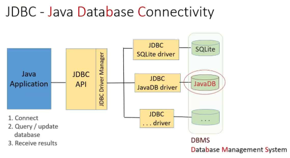
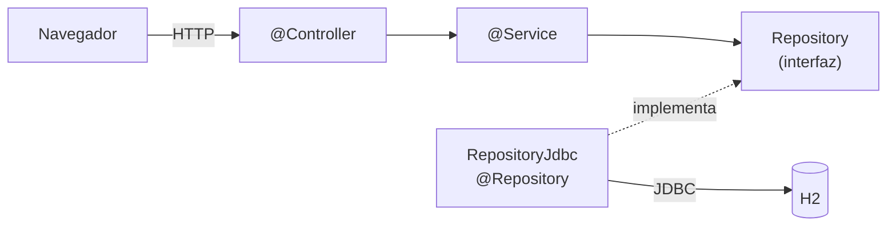
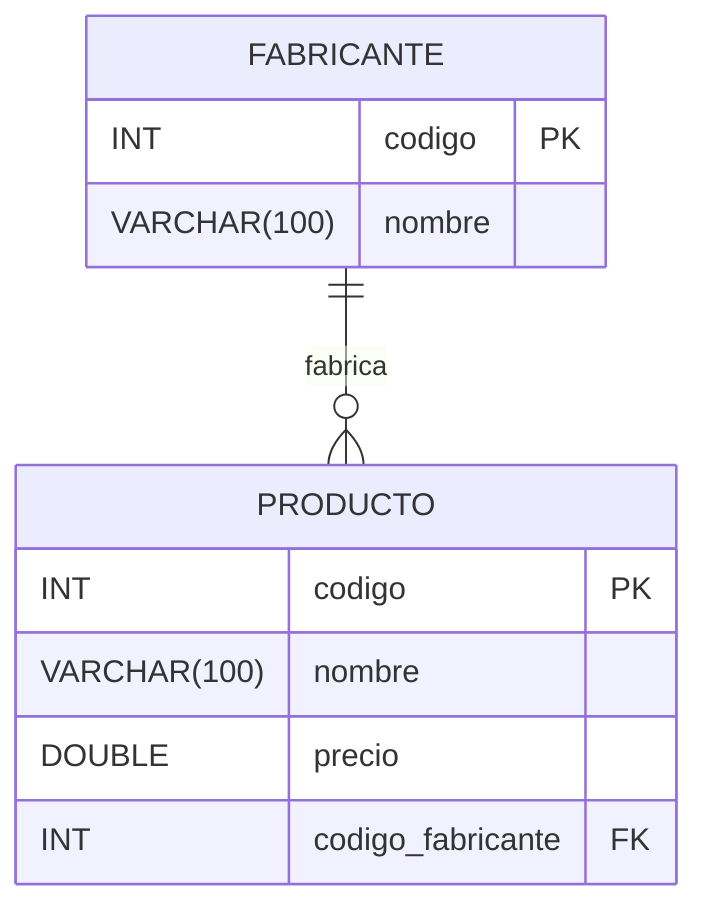
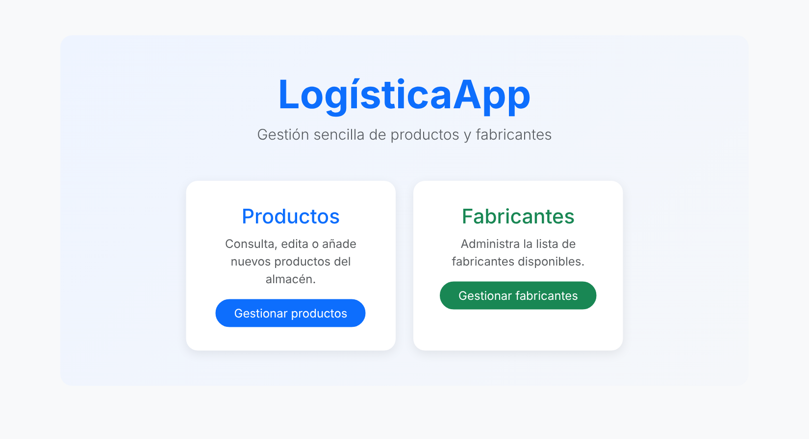
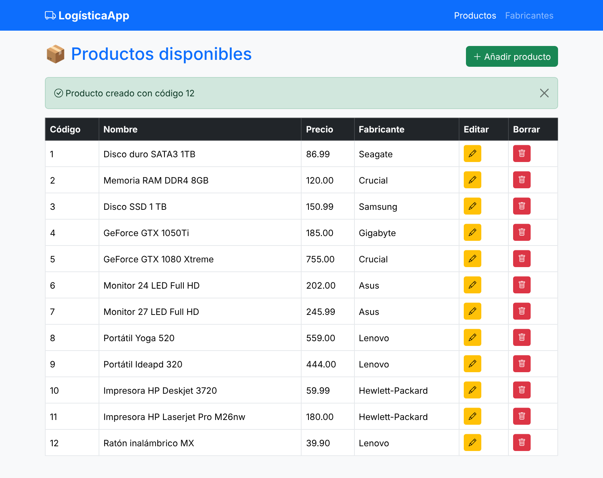
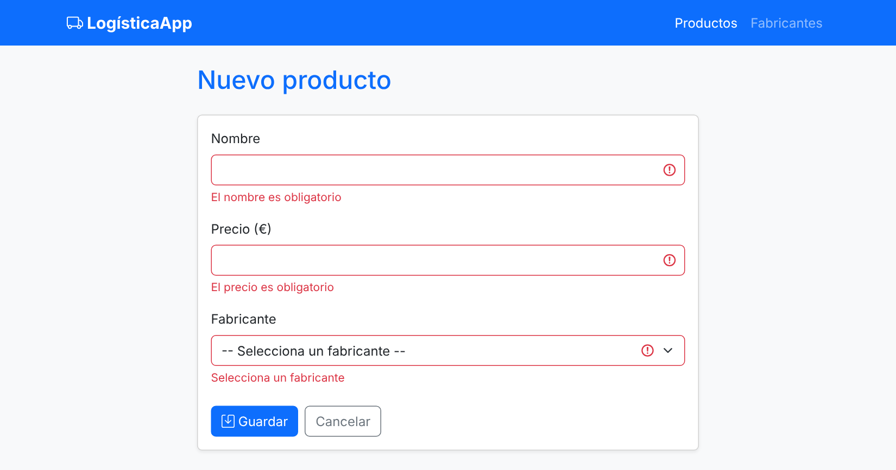
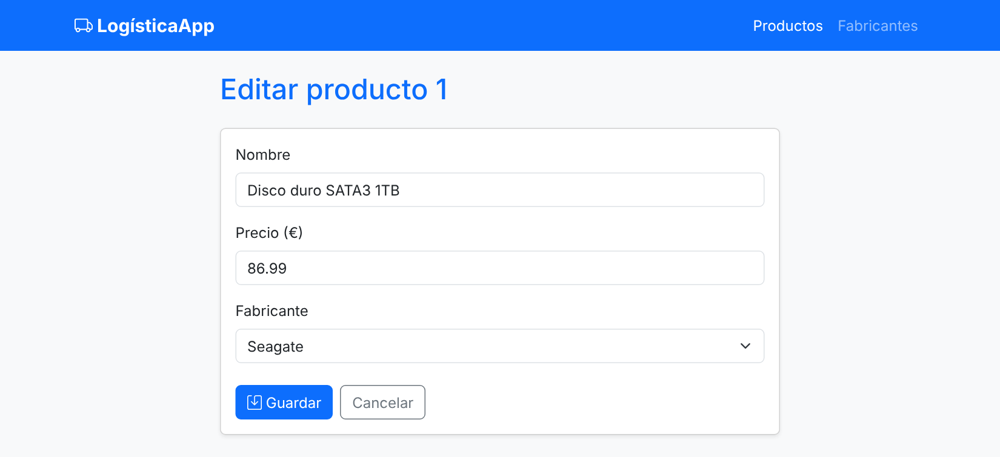
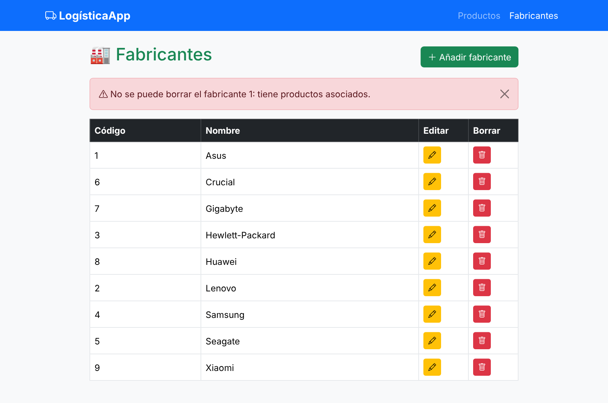
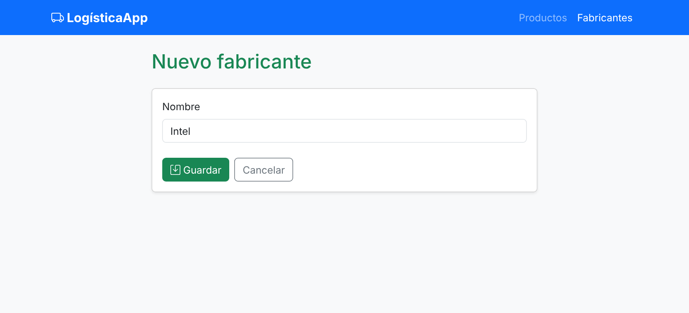
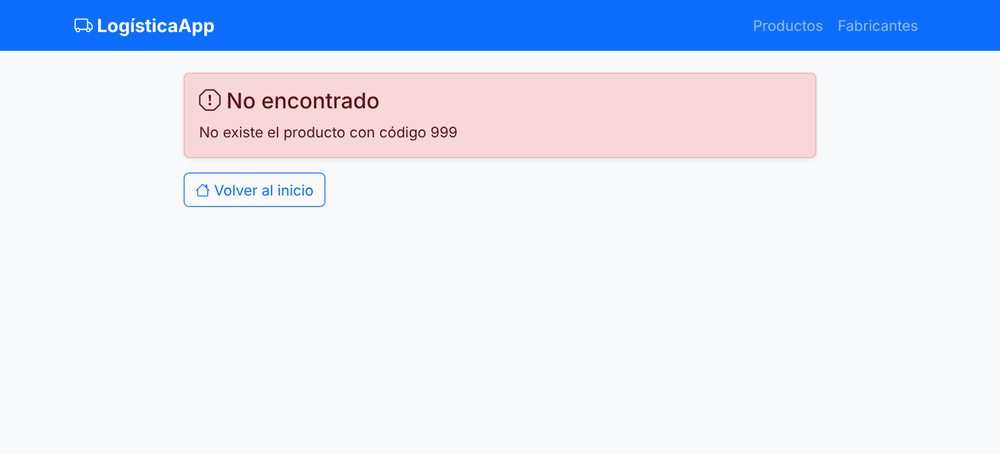

# Práctica guiada: LogísticaApp con Spring y JDBC



---

## Contexto

Vais a construir una aplicación web sencilla, **LogísticaApp**, que gestiona **productos** y sus **fabricantes**. El acceso a datos se hace con **JDBC** (`DataSource`, `Connection`, `PreparedStatement`, `ResultSet`) dentro de **Spring Boot**, y la interfaz es una web con **Thymeleaf** que permite probar el CRUD completo.

Es la primera parte de un ejercicio en dos fases:

1. **Ahora (UT02): JDBC.** Escribís vosotros el SQL y el mapeo de filas a objetos, incluida la relación entre tablas. Así veréis qué hay debajo de lo que hace JPA.
2. **Más adelante (UT04): JPA.** Sustituiréis la capa de repositorio por JPA **sin tocar servicios, controladores ni vistas**, y comprobaréis qué trabajo os quita.

No usamos todavía JPA/Hibernate. Aquí solo hay JDBC, pero **la conexión no la creáis vosotros, os la da Spring**.

## Arquitectura en capas



| Capa | Responsabilidad | No debe saber nada de... |
|---|---|---|
| `@Controller` | HTTP: recibir peticiones, elegir la vista, mensajes al usuario | SQL, JDBC, reglas de negocio |
| `@Service` | Reglas de negocio: qué se puede hacer y qué hay que comprobar antes | HTTP, `Model`, vistas, JDBC |
| `@Repository` | Acceso a datos: SQL y mapeo fila → objeto | Reglas de negocio, HTTP |

Cada capa solo habla con la de su derecha. **El controlador nunca usa un repositorio.**

## Qué vais a construir

| URL | Método | Qué hace | Servicio → repositorio |
|---|---|---|---|
| `/` | GET | Portada con acceso a productos y fabricantes | — |
| `/productos` | GET | Tabla de productos con su fabricante | `listar()` → `findAll()` |
| `/productos/nuevo` | GET | Formulario vacío | `FabricanteService.listar()` para el desplegable |
| `/productos/editar/{codigo}` | GET | Formulario relleno | `buscarPorCodigo()` → `findById()` |
| `/productos/guardar` | POST | Alta o modificación | `crear()` → `save()` / `actualizar()` → `update()` |
| `/productos/borrar/{codigo}` | POST | Borrado | `borrar()` → `delete()` |
| `/fabricantes/...` | — | Lo mismo para fabricantes | Ídem |
| `/h2-console` | GET | Consola de la base de datos | — |

## Modelo de datos

Relación **1:N**: un fabricante tiene muchos productos; cada producto pertenece a un único fabricante.



La clave ajena `codigo_fabricante` está en el lado **N** (producto). Consecuencia que veréis en la web: **no se puede borrar un fabricante que tenga productos**.

---
## Así queda la aplicación

| # | Vista | URL | Paso |
|---|---|---|---|
| 1 | [Portada](#1-portada) | `/` | [Paso 10](#paso-10-plantilla-común-y-portada) |
| 2 | [Listado de productos](#2-listado-de-productos) | `/productos` | [Paso 11](#paso-11-listado-de-productos-read) |
| 3 | [Alta de producto con errores de validación](#3-alta-de-producto-con-errores-de-validación) | `/productos/nuevo` → Guardar | [Paso 12](#paso-12-alta-y-edición-create--update) |
| 4 | [Edición de producto](#4-edición-de-producto) | `/productos/editar/1` | [Paso 12](#paso-12-alta-y-edición-create--update) |
| 5 | [Listado de fabricantes](#5-listado-de-fabricantes) | `/fabricantes` | [Paso 14](#paso-14-crud-de-fabricantes) |
| 6 | [Alta de fabricante](#6-alta-de-fabricante) | `/fabricantes/nuevo` | [Paso 14](#paso-14-crud-de-fabricantes) |
| 7 | [Página de error](#7-página-de-error) | `/productos/editar/999` | [Paso 9](#paso-9-errores-en-la-web) |

### 1. Portada



### 2. Listado de productos

Tras dar de alta un producto: mensaje flash verde y columnas para editar y borrar.



### 3. Alta de producto con errores de validación

Formulario enviado vacío: `@Valid` + `BindingResult` devuelven los tres errores.



### 4. Edición de producto

Mismo formulario que el alta, relleno con los datos del producto y su fabricante seleccionado.



### 5. Listado de fabricantes

Intento de borrar Asus, que tiene productos: el servicio lo impide y se muestra el aviso en rojo.



### 6. Alta de fabricante



### 7. Página de error

Código inexistente: `RecursoNoEncontradoException` → `GlobalExceptionHandler` → `error.html` (404).




---
## Paso 0. Crear el proyecto

En IntelliJ → *New Project* → *Spring Boot*:

- **Name:** `ProductosJdbc` · **Group:** `es.daw` · **Package name:** `es.daw.productosjdbc`
- **Java:** 25 · **Type:** Maven

Dependencias:

| Dependencia en Initializr | Para qué |
|---|---|
| Spring Web | Controladores MVC y Tomcat embebido |
| Thymeleaf | Vistas |
| Validation | `@Valid`, `@NotBlank`, `@Positive`... |
| JDBC API | `DataSource` (pool HikariCP) configurado por Spring |
| H2 Database | Base de datos en memoria y consola `/h2-console` |
| JDBC | Jdbc API
| Spring Boot DevTools | Recarga automática |
| Lombok | `@Data`, constructores, `@Slf4j`... |

Paquetes que vais a crear dentro de `es.daw.productosjdbc`: `model`, `dto`, `repository`, `service`, `controller`, `exception`, `config`.

---

## Paso 1. `application.properties`

```properties
spring.application.name=productosJdbc

# --- Base de datos H2 en memoria ---
spring.datasource.url=jdbc:h2:mem:logisticadb;DB_CLOSE_DELAY=-1
spring.datasource.driverClassName=org.h2.Driver
spring.datasource.username=sa
spring.datasource.password=

# Ejecutar schema.sql y data.sql al arrancar (por defecto ya lo hace con BD embebidas)
spring.sql.init.mode=always
spring.sql.init.encoding=UTF-8

# --- Consola H2 ---
spring.h2.console.enabled=true
spring.h2.console.path=/h2-console
```

---

## Paso 2. Base de datos: DDL y datos de prueba

Spring Boot ejecuta automáticamente, al arrancar, `schema.sql` (estructura) y después `data.sql` (datos).

### `src/main/resources/schema.sql`

```sql
-- Se borran en orden inverso a las dependencias (primero la tabla "hija")
DROP TABLE IF EXISTS producto;
DROP TABLE IF EXISTS fabricante;

-- Tabla "padre": lado 1 de la relación
CREATE TABLE fabricante (
    codigo INT          AUTO_INCREMENT PRIMARY KEY,
    nombre VARCHAR(100) NOT NULL
);

-- Tabla "hija": lado N de la relación (cada producto tiene UN fabricante)
CREATE TABLE producto (
    codigo            INT          AUTO_INCREMENT PRIMARY KEY,
    nombre            VARCHAR(100) NOT NULL,
    precio            DOUBLE       NOT NULL,
    codigo_fabricante INT          NOT NULL,
    CONSTRAINT fk_producto_fabricante
        FOREIGN KEY (codigo_fabricante) REFERENCES fabricante (codigo)
);
```

Fijaos en el orden: se crea primero la tabla **padre** (`fabricante`), porque la FK de `producto` la referencia. Al borrar es al revés.

### `src/main/resources/data.sql`

```sql
-- Fabricantes (Huawei y Xiaomi no tienen productos: se podrán borrar)
INSERT INTO fabricante (nombre) VALUES ('Asus');            -- 1
INSERT INTO fabricante (nombre) VALUES ('Lenovo');          -- 2
INSERT INTO fabricante (nombre) VALUES ('Hewlett-Packard'); -- 3
INSERT INTO fabricante (nombre) VALUES ('Samsung');         -- 4
INSERT INTO fabricante (nombre) VALUES ('Seagate');         -- 5
INSERT INTO fabricante (nombre) VALUES ('Crucial');         -- 6
INSERT INTO fabricante (nombre) VALUES ('Gigabyte');        -- 7
INSERT INTO fabricante (nombre) VALUES ('Huawei');          -- 8
INSERT INTO fabricante (nombre) VALUES ('Xiaomi');          -- 9

-- Productos
INSERT INTO producto (nombre, precio, codigo_fabricante) VALUES ('Disco duro SATA3 1TB', 86.99, 5);
INSERT INTO producto (nombre, precio, codigo_fabricante) VALUES ('Memoria RAM DDR4 8GB', 120, 6);
INSERT INTO producto (nombre, precio, codigo_fabricante) VALUES ('Disco SSD 1 TB', 150.99, 4);
INSERT INTO producto (nombre, precio, codigo_fabricante) VALUES ('GeForce GTX 1050Ti', 185, 7);
INSERT INTO producto (nombre, precio, codigo_fabricante) VALUES ('GeForce GTX 1080 Xtreme', 755, 6);
INSERT INTO producto (nombre, precio, codigo_fabricante) VALUES ('Monitor 24 LED Full HD', 202, 1);
INSERT INTO producto (nombre, precio, codigo_fabricante) VALUES ('Monitor 27 LED Full HD', 245.99, 1);
INSERT INTO producto (nombre, precio, codigo_fabricante) VALUES ('Portátil Yoga 520', 559, 2);
INSERT INTO producto (nombre, precio, codigo_fabricante) VALUES ('Portátil Ideapd 320', 444, 2);
INSERT INTO producto (nombre, precio, codigo_fabricante) VALUES ('Impresora HP Deskjet 3720', 59.99, 3);
INSERT INTO producto (nombre, precio, codigo_fabricante) VALUES ('Impresora HP Laserjet Pro M26nw', 180, 3);
```

### ✅ Comprobación

Arrancad la aplicación (aún dará 404 en `/`, es normal) y entrad en `http://localhost:8080/h2-console`:

- **JDBC URL:** `jdbc:h2:mem:logisticadb` · **User:** `sa` · **Password:** vacía


Ejecutad:

```sql
SELECT p.codigo, p.nombre, p.precio, f.nombre AS fabricante
FROM producto p
JOIN fabricante f ON p.codigo_fabricante = f.codigo
ORDER BY p.codigo;
```

Probad también a romper la FK a mano y leed el error:

```sql
DELETE FROM fabricante WHERE codigo = 1;   -- Asus tiene productos → error
DELETE FROM fabricante WHERE codigo = 9;   -- Xiaomi no tiene → se borra
```

---

## Paso 3. El modelo

Clases Java normales (POJO), **sin anotaciones de persistencia**.

### `model/Fabricante.java`

```java
/**
 * Fila de la tabla FABRICANTE.
 * POJO sin anotaciones de persistencia: el mapeo fila → objeto lo hacemos a mano con JDBC.
 * (Las anotaciones de validación son para el formulario web, no para la BD).
 */
@Data
@NoArgsConstructor
@AllArgsConstructor
public class Fabricante {

    private Integer codigo;

    @NotBlank(message = "El nombre es obligatorio")
    @Size(max = 100, message = "Máximo 100 caracteres")
    private String nombre;
}
```

### `model/Producto.java`

```java
/**
 * Fila de la tabla PRODUCTO.
 *
 * En la tabla hay una columna codigo_fabricante (un INT, la FK).
 * En Java NO guardamos ese INT suelto: guardamos el objeto Fabricante completo.
 * Rellenarlo es trabajo nuestro (JOIN + mapeo manual). En la UT04, JPA lo hará con @ManyToOne.
 */
@Data
@NoArgsConstructor
@AllArgsConstructor
public class Producto {

    private Integer codigo;
    private String nombre;
    private double precio;
    private Fabricante fabricante;
}
```

| En la tabla `producto` | En la clase `Producto` |
|---|---|
| `codigo_fabricante INT` | `Fabricante fabricante` |
| Un número (la FK) | Un objeto completo con código y nombre |

Pasar de una cosa a la otra es **trabajo vuestro** en JDBC (paso 6). En JPA lo hará `@ManyToOne`.

---

## Paso 4. Las interfaces de repositorio

Las operaciones CRUD son las mismas para productos y fabricantes; solo cambian el **tipo de entidad** y el **tipo de su clave**. Por eso las definimos una sola vez en una interfaz genérica.

Fijaos en que **los métodos no declaran `throws SQLException`**. `SQLException` es un detalle de JDBC: si apareciera en la interfaz, todo el que la use (servicios, controladores) quedaría atado a JDBC, y al pasar a JPA habría que cambiarlos. Los errores de BD los traduciremos a una excepción propia (paso 5).

### `repository/GenericRepository.java`

```java
/**
 * Operaciones CRUD comunes a cualquier entidad.
 *
 * @param <T>  tipo de la entidad (Producto, Fabricante...)
 * @param <ID> tipo de su clave primaria (Integer, Long, String...)
 */
public interface GenericRepository<T, ID> {

    void save(T entidad);

    Optional<T> findById(ID id);

    List<T> findAll();

    void update(T entidad);

    void delete(ID id);
}
```

### `repository/ProductoRepository.java`

```java
/**
 * Repositorio de productos: hereda el CRUD fijando T = Producto, ID = Integer
 * y añade las consultas propias de productos.
 */
public interface ProductoRepository extends GenericRepository<Producto, Integer> {

    /** ¿Hay algún producto de este fabricante? Lo usa FabricanteService antes de borrar. */
    boolean existsByFabricanteCodigo(Integer codigoFabricante);
}
```

### `repository/FabricanteRepository.java`

```java
public interface FabricanteRepository extends GenericRepository<Fabricante, Integer> {
}
```

| Interfaz | Qué aporta |
|---|---|
| `GenericRepository<T, ID>` | El contrato CRUD, escrito una sola vez |
| `ProductoRepository` | Fija los tipos y añade consultas propias de productos |
| `FabricanteRepository` | Fija los tipos para fabricantes |

> **Para la UT04:** Spring Data JPA usa esta misma idea. Su `JpaRepository<T, ID>` es una interfaz genérica como la nuestra, y vuestras interfaces la extenderán igual: `ProductoRepository extends JpaRepository<Producto, Integer>`. Y el nombre `existsByFabricanteCodigo` no es casual: con Spring Data **basta con declarar el método** para que genere la consulta.

---

## Paso 5. Excepciones propias

Tres excepciones, una por cada tipo de problema. Todas son `RuntimeException` (no obligan a `throws` ni a `try/catch`).

| Excepción | Quién la lanza | Cuándo |
|---|---|---|
| `AccesoDatosException` | Repositorio | Falla el SQL o la conexión (envuelve la `SQLException`) |
| `RecursoNoEncontradoException` | Servicio | Se pide un código que no existe |
| `FabricanteConProductosException` | Servicio | Regla de negocio: borrar un fabricante con productos |

### `exception/AccesoDatosException.java`

```java
/**
 * Error técnico al acceder a la BD.
 * Envuelve la SQLException original (causa) para no perder la información del error.
 */
public class AccesoDatosException extends RuntimeException {

    public AccesoDatosException(String mensaje, Throwable causa) {
        super(mensaje, causa);
    }
}
```

### `exception/RecursoNoEncontradoException.java`

```java
/** Se lanza cuando findById devuelve Optional.empty() y necesitamos el objeto. */
public class RecursoNoEncontradoException extends RuntimeException {

    public RecursoNoEncontradoException(String mensaje) {
        super(mensaje);
    }
}
```

### `exception/FabricanteConProductosException.java`

```java
/** Regla de negocio: no se borra un fabricante que tiene productos. */
public class FabricanteConProductosException extends RuntimeException {

    public FabricanteConProductosException(Integer codigo) {
        super("No se puede borrar el fabricante " + codigo + ": tiene productos asociados.");
    }
}
```

---

## Paso 6. `ProductoRepositoryJdbc`

### Repaso rápido de JDBC

| Objeto | Qué es | Quién lo crea aquí |
|---|---|---|
| `DataSource` | Fábrica de conexiones (en Spring Boot, un pool HikariCP) | **Spring**, a partir de `application.properties` |
| `Connection` | Una conexión abierta con la BD | `dataSource.getConnection()` |
| `PreparedStatement` | Sentencia SQL precompilada con parámetros `?` | `con.prepareStatement(sql)` |
| `ResultSet` | Cursor sobre las filas de un `SELECT` | `ps.executeQuery()` |

| Método | Para | Devuelve |
|---|---|---|
| `executeQuery()` | `SELECT` | `ResultSet` |
| `executeUpdate()` | `INSERT`, `UPDATE`, `DELETE` | `int` (filas afectadas) |
| `getGeneratedKeys()` | Tras un `INSERT` con `RETURN_GENERATED_KEYS` | `ResultSet` con las claves generadas |

> Con un pool, `con.close()` **no cierra** la conexión física: la devuelve al pool para reutilizarla. Por eso cerrarla siempre (try-with-resources) es obligatorio.

### Reglas

- Siempre `PreparedStatement` con parámetros `?`. **Nunca concatenéis valores en el SQL.**
- Siempre `try-with-resources` para cerrar `Connection`, `PreparedStatement` y `ResultSet`.
- `findById` devuelve `Optional.empty()` si no existe, **nunca `null`**.
- En `save`, recuperad el código generado (`Statement.RETURN_GENERATED_KEYS`) y asignadlo al objeto.
- Toda `SQLException` se captura **aquí** y se relanza como `AccesoDatosException`. Ninguna `SQLException` sale del repositorio.

### `repository/ProductoRepositoryJdbc.java`

```java
@Repository
public class ProductoRepositoryJdbc implements ProductoRepository {

    /*
     * SELECT común a findById y findAll.
     * Hacemos JOIN con fabricante para traer también su nombre y poder construir
     * el objeto Fabricante dentro de cada Producto.
     * Los alias (f_codigo, f_nombre) evitan la ambigüedad: las dos tablas tienen "codigo" y "nombre".
     */
    private static final String SELECT_BASE = """
            SELECT p.codigo, p.nombre, p.precio,
                   f.codigo AS f_codigo, f.nombre AS f_nombre
            FROM producto p
            JOIN fabricante f ON p.codigo_fabricante = f.codigo
            """;

    private final DataSource dataSource;

    // Spring crea el DataSource a partir de application.properties y lo inyecta aquí
    public ProductoRepositoryJdbc(DataSource dataSource) {
        this.dataSource = dataSource;
    }

    // ---------------------------------------------------------------- READ (uno)
    @Override
    public Optional<Producto> findById(Integer codigo) {
        String sql = SELECT_BASE + "WHERE p.codigo = ?";
        try (Connection con = dataSource.getConnection();
             PreparedStatement ps = con.prepareStatement(sql)) {
            ps.setInt(1, codigo);
            try (ResultSet rs = ps.executeQuery()) {
                return rs.next() ? Optional.of(mapRow(rs)) : Optional.empty();
            }
        } catch (SQLException e) {
            throw new AccesoDatosException("Error al buscar el producto " + codigo, e);
        }
    }

    // ---------------------------------------------------------------- READ (todos)
    @Override
    public List<Producto> findAll() {
        String sql = SELECT_BASE + "ORDER BY p.codigo";
        List<Producto> productos = new ArrayList<>();
        try (Connection con = dataSource.getConnection();
             PreparedStatement ps = con.prepareStatement(sql);
             ResultSet rs = ps.executeQuery()) {
            while (rs.next()) {
                productos.add(mapRow(rs));
            }
        } catch (SQLException e) {
            throw new AccesoDatosException("Error al listar los productos", e);
        }
        return productos;
    }

    // ---------------------------------------------------------------- CREATE
    @Override
    public void save(Producto producto) {
        String sql = "INSERT INTO producto (nombre, precio, codigo_fabricante) VALUES (?, ?, ?)";
        try (Connection con = dataSource.getConnection();
             PreparedStatement ps = con.prepareStatement(sql, Statement.RETURN_GENERATED_KEYS)) {
            ps.setString(1, producto.getNombre());
            ps.setDouble(2, producto.getPrecio());
            ps.setInt(3, producto.getFabricante().getCodigo());
            ps.executeUpdate();

            // Recuperamos el código que ha generado AUTO_INCREMENT y se lo asignamos al objeto
            try (ResultSet claves = ps.getGeneratedKeys()) {
                if (claves.next()) {
                    producto.setCodigo(claves.getInt(1));
                }
            }
        } catch (SQLException e) {
            throw new AccesoDatosException("Error al guardar el producto", e);
        }
    }

    // ---------------------------------------------------------------- UPDATE
    @Override
    public void update(Producto producto) {
        String sql = "UPDATE producto SET nombre = ?, precio = ?, codigo_fabricante = ? WHERE codigo = ?";
        try (Connection con = dataSource.getConnection();
             PreparedStatement ps = con.prepareStatement(sql)) {
            ps.setString(1, producto.getNombre());
            ps.setDouble(2, producto.getPrecio());
            ps.setInt(3, producto.getFabricante().getCodigo());
            ps.setInt(4, producto.getCodigo());
            ps.executeUpdate();
        } catch (SQLException e) {
            throw new AccesoDatosException("Error al actualizar el producto " + producto.getCodigo(), e);
        }
    }

    // ---------------------------------------------------------------- DELETE
    @Override
    public void delete(Integer codigo) {
        String sql = "DELETE FROM producto WHERE codigo = ?";
        try (Connection con = dataSource.getConnection();
             PreparedStatement ps = con.prepareStatement(sql)) {
            ps.setInt(1, codigo);
            ps.executeUpdate();
        } catch (SQLException e) {
            throw new AccesoDatosException("Error al borrar el producto " + codigo, e);
        }
    }

    // ---------------------------------------------------------------- Consulta propia
    @Override
    public boolean existsByFabricanteCodigo(Integer codigoFabricante) {
        String sql = "SELECT 1 FROM producto WHERE codigo_fabricante = ?";
        try (Connection con = dataSource.getConnection();
             PreparedStatement ps = con.prepareStatement(sql)) {
            ps.setInt(1, codigoFabricante);
            try (ResultSet rs = ps.executeQuery()) {
                return rs.next();   // con que haya una fila, basta
            }
        } catch (SQLException e) {
            throw new AccesoDatosException(
                    "Error al comprobar los productos del fabricante " + codigoFabricante, e);
        }
    }

    // ---------------------------------------------------------------- Mapeo fila → objeto
    private Producto mapRow(ResultSet rs) throws SQLException {
        Fabricante fabricante = new Fabricante(
                rs.getInt("f_codigo"),
                rs.getString("f_nombre"));

        return new Producto(
                rs.getInt("codigo"),
                rs.getString("nombre"),
                rs.getDouble("precio"),
                fabricante);
    }
}
```

**Lo nuevo respecto a una tabla sola:**

- Para leer, `JOIN` con `fabricante` y alias (`f_codigo`, `f_nombre`) porque las dos tablas tienen columnas `codigo` y `nombre`.
- `mapRow` construye **dos objetos** por fila: el `Fabricante` y el `Producto` que lo contiene.
- Para escribir (`save`, `update`) solo hace falta el **código** del fabricante: `producto.getFabricante().getCodigo()`.
- El `catch (SQLException e) → throw new AccesoDatosException(...)` se repite en todos los métodos. Es lo que en Spring hace por vosotros `JdbcTemplate`, y en la UT04, JPA.

---

## Paso 7. `FabricanteRepositoryJdbc`

Mismo patrón, tabla sin relaciones.

### `repository/FabricanteRepositoryJdbc.java`

```java
@Repository
public class FabricanteRepositoryJdbc implements FabricanteRepository {

    private final DataSource dataSource;

    public FabricanteRepositoryJdbc(DataSource dataSource) {
        this.dataSource = dataSource;
    }

    @Override
    public Optional<Fabricante> findById(Integer codigo) {
        String sql = "SELECT codigo, nombre FROM fabricante WHERE codigo = ?";
        try (Connection con = dataSource.getConnection();
             PreparedStatement ps = con.prepareStatement(sql)) {
            ps.setInt(1, codigo);
            try (ResultSet rs = ps.executeQuery()) {
                return rs.next() ? Optional.of(mapRow(rs)) : Optional.empty();
            }
        } catch (SQLException e) {
            throw new AccesoDatosException("Error al buscar el fabricante " + codigo, e);
        }
    }

    @Override
    public List<Fabricante> findAll() {
        String sql = "SELECT codigo, nombre FROM fabricante ORDER BY nombre";
        List<Fabricante> fabricantes = new ArrayList<>();
        try (Connection con = dataSource.getConnection();
             PreparedStatement ps = con.prepareStatement(sql);
             ResultSet rs = ps.executeQuery()) {
            while (rs.next()) {
                fabricantes.add(mapRow(rs));
            }
        } catch (SQLException e) {
            throw new AccesoDatosException("Error al listar los fabricantes", e);
        }
        return fabricantes;
    }

    @Override
    public void save(Fabricante fabricante) {
        String sql = "INSERT INTO fabricante (nombre) VALUES (?)";
        try (Connection con = dataSource.getConnection();
             PreparedStatement ps = con.prepareStatement(sql, Statement.RETURN_GENERATED_KEYS)) {
            ps.setString(1, fabricante.getNombre());
            ps.executeUpdate();
            try (ResultSet claves = ps.getGeneratedKeys()) {
                if (claves.next()) {
                    fabricante.setCodigo(claves.getInt(1));
                }
            }
        } catch (SQLException e) {
            throw new AccesoDatosException("Error al guardar el fabricante", e);
        }
    }

    @Override
    public void update(Fabricante fabricante) {
        String sql = "UPDATE fabricante SET nombre = ? WHERE codigo = ?";
        try (Connection con = dataSource.getConnection();
             PreparedStatement ps = con.prepareStatement(sql)) {
            ps.setString(1, fabricante.getNombre());
            ps.setInt(2, fabricante.getCodigo());
            ps.executeUpdate();
        } catch (SQLException e) {
            throw new AccesoDatosException("Error al actualizar el fabricante " + fabricante.getCodigo(), e);
        }
    }

    /**
     * El servicio comprueba antes que no tenga productos.
     * Si aun así los tuviera, la FK lo impide y se lanza AccesoDatosException:
     * la BD es la última barrera.
     */
    @Override
    public void delete(Integer codigo) {
        String sql = "DELETE FROM fabricante WHERE codigo = ?";
        try (Connection con = dataSource.getConnection();
             PreparedStatement ps = con.prepareStatement(sql)) {
            ps.setInt(1, codigo);
            ps.executeUpdate();
        } catch (SQLException e) {
            throw new AccesoDatosException("Error al borrar el fabricante " + codigo, e);
        }
    }

    private Fabricante mapRow(ResultSet rs) throws SQLException {
        return new Fabricante(
                rs.getInt("codigo"),
                rs.getString("nombre"));
    }
}
```

---

## Paso 8. La capa de servicio

Los controladores **no hablan con los repositorios**: hablan con un servicio, y el servicio usa los repositorios.

Lo que hace el servicio (y no el controlador):

- Lanzar `RecursoNoEncontradoException` cuando `findById` devuelve vacío.
- Ofrecer operaciones con intención clara: `crear` y `actualizar`, no un `guardar` ambiguo.
- Comprobar reglas de negocio, aunque necesiten **varios repositorios**:
  - Un producto solo se guarda si su fabricante existe.
  - Un fabricante solo se borra si no tiene productos.
- Normalizar datos antes de guardarlos (quitar espacios al nombre).

### `service/ProductoService.java`

```java
@Service
public class ProductoService {

    // Dependemos de las INTERFACES, no de las clases ...Jdbc
    private final ProductoRepository productoRepository;
    private final FabricanteRepository fabricanteRepository;

    public ProductoService(ProductoRepository productoRepository,
                           FabricanteRepository fabricanteRepository) {
        this.productoRepository = productoRepository;
        this.fabricanteRepository = fabricanteRepository;
    }

    public List<Producto> listar() {
        return productoRepository.findAll();
    }

    public Producto buscarPorCodigo(Integer codigo) {
        return productoRepository.findById(codigo)
                .orElseThrow(() -> new RecursoNoEncontradoException(
                        "No existe el producto con código " + codigo));
    }

    /** Alta. Devuelve el producto con el código generado. */
    public Producto crear(Producto producto) {
        prepararParaGuardar(producto);
        productoRepository.save(producto);
        return producto;
    }

    /** Modificación. El producto tiene que existir. */
    public Producto actualizar(Producto producto) {
        buscarPorCodigo(producto.getCodigo());
        prepararParaGuardar(producto);
        productoRepository.update(producto);
        return producto;
    }

    public void borrar(Integer codigo) {
        buscarPorCodigo(codigo);
        productoRepository.delete(codigo);
    }

    // Reglas comunes a crear y actualizar
    private void prepararParaGuardar(Producto producto) {
        producto.setNombre(producto.getNombre().trim());

        // Regla de negocio: el fabricante tiene que existir
        Integer codigoFabricante = producto.getFabricante().getCodigo();
        Fabricante fabricante = fabricanteRepository.findById(codigoFabricante)
                .orElseThrow(() -> new RecursoNoEncontradoException(
                        "No existe el fabricante con código " + codigoFabricante));
        producto.setFabricante(fabricante);   // ahora lleva también el nombre
    }
}
```

### `service/FabricanteService.java`

```java
@Service
public class FabricanteService {

    private final FabricanteRepository fabricanteRepository;
    private final ProductoRepository productoRepository;

    public FabricanteService(FabricanteRepository fabricanteRepository,
                             ProductoRepository productoRepository) {
        this.fabricanteRepository = fabricanteRepository;
        this.productoRepository = productoRepository;
    }

    public List<Fabricante> listar() {
        return fabricanteRepository.findAll();
    }

    public Fabricante buscarPorCodigo(Integer codigo) {
        return fabricanteRepository.findById(codigo)
                .orElseThrow(() -> new RecursoNoEncontradoException(
                        "No existe el fabricante con código " + codigo));
    }

    public Fabricante crear(Fabricante fabricante) {
        fabricante.setNombre(fabricante.getNombre().trim());
        fabricanteRepository.save(fabricante);
        return fabricante;
    }

    public Fabricante actualizar(Fabricante fabricante) {
        buscarPorCodigo(fabricante.getCodigo());
        fabricante.setNombre(fabricante.getNombre().trim());
        fabricanteRepository.update(fabricante);
        return fabricante;
    }

    public void borrar(Integer codigo) {
        buscarPorCodigo(codigo);

        // Regla de negocio: comprobada aquí, antes de llegar a la BD
        if (productoRepository.existsByFabricanteCodigo(codigo)) {
            throw new FabricanteConProductosException(codigo);
        }
        fabricanteRepository.delete(codigo);
    }
}
```

| | Sin servicio (todo en el controlador) | Con servicio |
|---|---|---|
| ¿Quién sabe que un fabricante con productos no se borra? | Nadie: se entera la BD y el controlador captura un error de SQL | `FabricanteService`, que lo comprueba y lanza una excepción con significado |
| Si mañana hay una API REST además de la web | Copiar las reglas en el nuevo controlador | Los dos controladores llaman al mismo servicio |
| En la UT04 (JPA) | Cambiar los controladores | Solo cambian los repositorios |

---

## Paso 9. Errores en la web

Un `@ControllerAdvice` recoge las excepciones que lleguen a cualquier controlador y muestra una página de error. Así los controladores no repiten `try/catch`.

### `exception/GlobalExceptionHandler.java`

```java
/**
 * Manejo centralizado de errores para TODOS los controladores.
 * Las excepciones que el controlador no captura acaban aquí.
 */
@Slf4j
@ControllerAdvice
public class GlobalExceptionHandler {

    @ExceptionHandler(RecursoNoEncontradoException.class)
    @ResponseStatus(HttpStatus.NOT_FOUND)
    public String noEncontrado(RecursoNoEncontradoException ex, Model model) {
        model.addAttribute("titulo", "No encontrado");
        model.addAttribute("mensaje", ex.getMessage());
        return "error";
    }

    @ExceptionHandler(AccesoDatosException.class)
    @ResponseStatus(HttpStatus.INTERNAL_SERVER_ERROR)
    public String errorAccesoDatos(AccesoDatosException ex, Model model) {
        // La causa (la SQLException original) va al log, no al usuario
        log.error(ex.getMessage(), ex);
        model.addAttribute("titulo", "Error de base de datos");
        model.addAttribute("mensaje", ex.getMessage());
        return "error";
    }
}
```

### `templates/error.html`

```html
<!DOCTYPE html>
<html lang="es" xmlns:th="http://www.thymeleaf.org">
<head th:replace="~{fragments/layout :: head('Error')}"></head>
<body>
<nav th:replace="~{fragments/layout :: navbar}"></nav>

<!-- La usan nuestro GlobalExceptionHandler (titulo, mensaje)
     y también Spring Boot para errores no controlados (status, error) -->
<div class="container" style="max-width: 720px;">
    <div class="alert alert-danger shadow-sm">
        <h4 class="alert-heading">
            <i class="bi bi-exclamation-octagon"></i>
            <span th:text="${titulo} ?: (${status} + ' ' + ${error})">Error</span>
        </h4>
        <p class="mb-0" th:text="${mensaje} ?: 'Se ha producido un error inesperado.'">Detalle</p>
    </div>
    <a th:href="@{/}" class="btn btn-outline-primary"><i class="bi bi-house"></i> Volver al inicio</a>
</div>

</body>
</html>
```

---

## Paso 10. Plantilla común y portada

### `templates/fragments/layout.html`

Fragmentos reutilizables: `<head>`, barra de navegación, mensajes y scripts.

```html
<!DOCTYPE html>
<html lang="es" xmlns:th="http://www.thymeleaf.org">

<!-- Fragmento 1: <head> común. Recibe el título de la página -->
<head th:fragment="head(titulo)">
    <meta charset="UTF-8">
    <meta name="viewport" content="width=device-width, initial-scale=1">
    <title th:text="${titulo} + ' · LogísticaApp'">LogísticaApp</title>
    <link rel="stylesheet" href="https://cdn.jsdelivr.net/npm/bootstrap@5.3.3/dist/css/bootstrap.min.css">
    <link rel="stylesheet" href="https://cdn.jsdelivr.net/npm/bootstrap-icons@1.11.3/font/bootstrap-icons.min.css">
    <link rel="stylesheet" th:href="@{/css/estilos.css}">
</head>

<body>

<!-- Fragmento 2: barra de navegación -->
<nav th:fragment="navbar" class="navbar navbar-expand navbar-dark bg-primary mb-4">
    <div class="container">
        <a class="navbar-brand fw-bold" th:href="@{/}"><i class="bi bi-truck"></i> LogísticaApp</a>
        <div class="navbar-nav">
            <a class="nav-link" th:href="@{/productos}">Productos</a>
            <a class="nav-link" th:href="@{/fabricantes}">Fabricantes</a>
        </div>
    </div>
</nav>

<!-- Fragmento 3: mensajes flash (éxito / error) tras un redirect -->
<div th:fragment="alertas">
    <div th:if="${mensaje}" class="alert alert-success alert-dismissible fade show">
        <i class="bi bi-check-circle"></i> <span th:text="${mensaje}">Mensaje</span>
        <button type="button" class="btn-close" data-bs-dismiss="alert"></button>
    </div>
    <div th:if="${error}" class="alert alert-danger alert-dismissible fade show">
        <i class="bi bi-exclamation-triangle"></i> <span th:text="${error}">Error</span>
        <button type="button" class="btn-close" data-bs-dismiss="alert"></button>
    </div>
</div>

<!-- Fragmento 4: scripts al final del body -->
<th:block th:fragment="scripts">
    <script src="https://cdn.jsdelivr.net/npm/bootstrap@5.3.3/dist/js/bootstrap.bundle.min.js"></script>
</th:block>

</body>
</html>
```

### `static/css/estilos.css`

```css
body {
    background-color: #f8f9fa;
}

/* Portada */
.hero {
    background: linear-gradient(135deg, #eef4ff 0%, #f5f7fa 100%);
    border-radius: 1rem;
    padding: 3rem 1rem;
}

.hero h1 {
    color: #0d6efd;
    font-weight: 700;
}

.tarjeta {
    border: none;
    border-radius: 1rem;
    box-shadow: 0 4px 14px rgba(0, 0, 0, .08);
    transition: transform .15s;
}

.tarjeta:hover {
    transform: translateY(-4px);
}

/* Tablas */
.titulo-seccion {
    color: #0d6efd;
}

.col-accion {
    width: 90px;
}
```

### `config/WebConfig.java`

```java
@Configuration
public class WebConfig implements WebMvcConfigurer {

    // Vistas sin lógica: no necesitan un @Controller
    @Override
    public void addViewControllers(ViewControllerRegistry registry) {
        registry.addViewController("/").setViewName("index");
    }
}
```

### `templates/index.html`

```html
<!DOCTYPE html>
<html lang="es" xmlns:th="http://www.thymeleaf.org">
<head th:replace="~{fragments/layout :: head('Inicio')}"></head>
<body>

<div class="container py-5">
    <div class="hero text-center">
        <h1 class="display-4">LogísticaApp</h1>
        <p class="lead text-muted mb-5">Gestión sencilla de productos y fabricantes</p>

        <div class="row justify-content-center g-4">
            <div class="col-md-5 col-lg-4">
                <div class="card tarjeta h-100 p-3">
                    <div class="card-body">
                        <h3 class="text-primary">Productos</h3>
                        <p class="text-muted">Consulta, edita o añade nuevos productos del almacén.</p>
                        <a th:href="@{/productos}" class="btn btn-primary rounded-pill px-4">Gestionar productos</a>
                    </div>
                </div>
            </div>
            <div class="col-md-5 col-lg-4">
                <div class="card tarjeta h-100 p-3">
                    <div class="card-body">
                        <h3 class="text-success">Fabricantes</h3>
                        <p class="text-muted">Administra la lista de fabricantes disponibles.</p>
                        <a th:href="@{/fabricantes}" class="btn btn-success rounded-pill px-4">Gestionar fabricantes</a>
                    </div>
                </div>
            </div>
        </div>
    </div>
</div>

</body>
</html>
```

### ✅ Comprobación

`http://localhost:8080/` muestra la portada con las dos tarjetas. Los botones todavía dan error (404).

---

## Paso 11. Listado de productos (READ)

### `controller/ProductoController.java` (primera versión)

```java
@Controller
@RequestMapping("/productos")
public class ProductoController {

    // El controlador solo conoce SERVICIOS, nunca repositorios
    private final ProductoService productoService;
    private final FabricanteService fabricanteService;

    public ProductoController(ProductoService productoService,
                              FabricanteService fabricanteService) {
        this.productoService = productoService;
        this.fabricanteService = fabricanteService;
    }

    // READ: listado
    @GetMapping
    public String listar(Model model) {
        model.addAttribute("productos", productoService.listar());
        return "productos/lista";
    }

    // (aquí irán los métodos de los pasos 12 y 13)
}
```

### `templates/productos/lista.html`

```html
<!DOCTYPE html>
<html lang="es" xmlns:th="http://www.thymeleaf.org">
<head th:replace="~{fragments/layout :: head('Productos')}"></head>
<body>
<nav th:replace="~{fragments/layout :: navbar}"></nav>

<div class="container">

    <div class="d-flex justify-content-between align-items-center mb-3">
        <h2 class="titulo-seccion">📦 Productos disponibles</h2>
        <a th:href="@{/productos/nuevo}" class="btn btn-success">
            <i class="bi bi-plus-lg"></i> Añadir producto
        </a>
    </div>

    <div th:replace="~{fragments/layout :: alertas}"></div>

    <table class="table table-bordered table-hover bg-white align-middle">
        <thead class="table-dark">
        <tr>
            <th>Código</th>
            <th>Nombre</th>
            <th>Precio</th>
            <th>Fabricante</th>
            <th class="col-accion">Editar</th>
            <th class="col-accion">Borrar</th>
        </tr>
        </thead>
        <tbody>
        <tr th:if="${#lists.isEmpty(productos)}">
            <td colspan="6" class="text-center text-muted">No hay productos</td>
        </tr>
        <tr th:each="p : ${productos}">
            <td th:text="${p.codigo}">1</td>
            <td th:text="${p.nombre}">Nombre</td>
            <td th:text="${#numbers.formatDecimal(p.precio, 1, 2, 'POINT')}">0.00</td>
            <!-- Navegamos por el objeto: Producto → Fabricante → nombre -->
            <td th:text="${p.fabricante.nombre}">Fabricante</td>
            <td>
                <a th:href="@{/productos/editar/{codigo}(codigo=${p.codigo})}"
                   class="btn btn-warning btn-sm" title="Editar">
                    <i class="bi bi-pencil"></i>
                </a>
            </td>
            <td>
                <!-- Borrar = POST. Pedimos confirmación en el navegador -->
                <form th:action="@{/productos/borrar/{codigo}(codigo=${p.codigo})}" method="post"
                      onsubmit="return confirm('¿Seguro que quieres borrar este producto?');">
                    <button type="submit" class="btn btn-danger btn-sm" title="Borrar">
                        <i class="bi bi-trash"></i>
                    </button>
                </form>
            </td>
        </tr>
        </tbody>
    </table>
</div>

<th:block th:replace="~{fragments/layout :: scripts}"></th:block>
</body>
</html>
```

### ✅ Comprobación

`/productos` muestra los 11 productos **con el nombre del fabricante**. Ese nombre llega por el `JOIN` del repositorio y Thymeleaf lo lee navegando por el objeto: `${p.fabricante.nombre}`.

---

## Paso 12. Alta y edición (CREATE / UPDATE)

El mismo formulario sirve para crear y para editar: si el campo oculto `codigo` va vacío es un alta; si lleva valor, una modificación. El controlador lo distingue y llama a `crear` o a `actualizar` del servicio.

### `dto/ProductoForm.java`

```java
/**
 * Objeto del formulario de producto (lo que viaja entre la vista y el controlador).
 *
 * ¿Por qué no usamos Producto directamente?
 * El <select> solo envía el código del fabricante (un número), no un Fabricante completo.
 * Aquí lo recogemos como Integer y lo validamos; después lo convertimos a Producto.
 */
@Data
@NoArgsConstructor
public class ProductoForm {

    private Integer codigo;            // null = alta, con valor = edición

    @NotBlank(message = "El nombre es obligatorio")
    @Size(max = 100, message = "Máximo 100 caracteres")
    private String nombre;

    @NotNull(message = "El precio es obligatorio")
    @Positive(message = "El precio debe ser mayor que 0")
    private Double precio;

    @NotNull(message = "Selecciona un fabricante")
    private Integer codigoFabricante;

    /** Producto (modelo) → formulario (vista). Se usa al editar. */
    public static ProductoForm desde(Producto p) {
        ProductoForm form = new ProductoForm();
        form.setCodigo(p.getCodigo());
        form.setNombre(p.getNombre());
        form.setPrecio(p.getPrecio());
        form.setCodigoFabricante(p.getFabricante().getCodigo());
        return form;
    }

    /** Formulario (vista) → Producto (modelo). Del fabricante solo tenemos el código. */
    public Producto aProducto() {
        Fabricante fabricante = new Fabricante(codigoFabricante, null);
        return new Producto(codigo, nombre, precio, fabricante);
    }
}
```

### Añadir a `ProductoController`

```java
    // Formulario vacío para alta
    @GetMapping("/nuevo")
    public String nuevo(Model model) {
        model.addAttribute("productoForm", new ProductoForm());
        model.addAttribute("fabricantes", fabricanteService.listar());
        return "productos/formulario";
    }

    // Formulario relleno para edición
    @GetMapping("/editar/{codigo}")
    public String editar(@PathVariable Integer codigo, Model model) {
        Producto producto = productoService.buscarPorCodigo(codigo);   // 404 si no existe

        model.addAttribute("productoForm", ProductoForm.desde(producto));
        model.addAttribute("fabricantes", fabricanteService.listar());
        return "productos/formulario";
    }

    // CREATE / UPDATE: el mismo formulario sirve para las dos operaciones
    @PostMapping("/guardar")
    public String guardar(@Valid @ModelAttribute ProductoForm productoForm,
                          BindingResult result,
                          Model model,
                          RedirectAttributes redirectAttributes) {

        if (result.hasErrors()) {
            // Volvemos al formulario: hay que recargar el desplegable
            model.addAttribute("fabricantes", fabricanteService.listar());
            return "productos/formulario";
        }

        if (productoForm.getCodigo() == null) {
            Producto creado = productoService.crear(productoForm.aProducto());
            redirectAttributes.addFlashAttribute("mensaje",
                    "Producto creado con código " + creado.getCodigo());
        } else {
            productoService.actualizar(productoForm.aProducto());
            redirectAttributes.addFlashAttribute("mensaje",
                    "Producto " + productoForm.getCodigo() + " actualizado");
        }

        // PRG (Post/Redirect/Get): si el usuario pulsa F5 no se reenvía el formulario
        return "redirect:/productos";
    }
```

### `templates/productos/formulario.html`

```html
<!DOCTYPE html>
<html lang="es" xmlns:th="http://www.thymeleaf.org">
<head th:replace="~{fragments/layout :: head('Producto')}"></head>
<body>
<nav th:replace="~{fragments/layout :: navbar}"></nav>

<div class="container" style="max-width: 640px;">

    <!-- Mismo formulario para alta y edición: lo distingue si hay código -->
    <h2 class="titulo-seccion mb-4"
        th:text="${productoForm.codigo == null} ? 'Nuevo producto' : ('Editar producto ' + ${productoForm.codigo})">
        Producto
    </h2>

    <form th:action="@{/productos/guardar}" th:object="${productoForm}" method="post"
          class="card card-body shadow-sm" novalidate>

        <!-- El código viaja oculto: vacío en alta, relleno en edición -->
        <input type="hidden" th:field="*{codigo}">

        <div class="mb-3">
            <label for="nombre" class="form-label">Nombre</label>
            <input type="text" th:field="*{nombre}" class="form-control"
                   th:classappend="${#fields.hasErrors('nombre')} ? 'is-invalid'">
            <div class="invalid-feedback" th:errors="*{nombre}">Error</div>
        </div>

        <div class="mb-3">
            <label for="precio" class="form-label">Precio (€)</label>
            <input type="number" step="0.01" min="0" th:field="*{precio}" class="form-control"
                   th:classappend="${#fields.hasErrors('precio')} ? 'is-invalid'">
            <div class="invalid-feedback" th:errors="*{precio}">Error</div>
        </div>

        <div class="mb-4">
            <label for="codigoFabricante" class="form-label">Fabricante</label>
            <!-- Se envía el CÓDIGO del fabricante; se muestra su NOMBRE -->
            <select th:field="*{codigoFabricante}" class="form-select"
                    th:classappend="${#fields.hasErrors('codigoFabricante')} ? 'is-invalid'">
                <option value="">-- Selecciona un fabricante --</option>
                <option th:each="f : ${fabricantes}"
                        th:value="${f.codigo}"
                        th:text="${f.nombre}">Fabricante</option>
            </select>
            <div class="invalid-feedback" th:errors="*{codigoFabricante}">Error</div>
        </div>

        <div class="d-flex gap-2">
            <button type="submit" class="btn btn-primary"><i class="bi bi-save"></i> Guardar</button>
            <a th:href="@{/productos}" class="btn btn-outline-secondary">Cancelar</a>
        </div>
    </form>
</div>

<th:block th:replace="~{fragments/layout :: scripts}"></th:block>
</body>
</html>
```

### ✅ Comprobación

| Prueba | Resultado esperado |
|---|---|
| *Añadir producto* sin rellenar nada → Guardar | Vuelve al formulario con los tres errores en rojo |
| Alta correcta | Redirige al listado con "Producto creado con código 12" |
| Editar el producto 1 y cambiar precio y fabricante | El listado muestra los cambios |
| `/productos/editar/999` | Página de error "No existe el producto con código 999" |
| Con las herramientas del navegador (F12), cambiar el `value` de un fabricante a `99` y guardar | Página de error "No existe el fabricante con código 99" (lo para el servicio) |
| Tras un alta, pulsar F5 en el listado | No se crea un producto duplicado (PRG) |

---

## Paso 13. Borrado (DELETE)

### Añadir a `ProductoController`

```java
    // DELETE: por POST, nunca por GET (un GET no debe modificar datos)
    @PostMapping("/borrar/{codigo}")
    public String borrar(@PathVariable Integer codigo,
                         RedirectAttributes redirectAttributes) {
        productoService.borrar(codigo);
        redirectAttributes.addFlashAttribute("mensaje", "Producto " + codigo + " borrado");
        return "redirect:/productos";
    }
```

El botón de borrar de `lista.html` ya está preparado: es un pequeño `<form method="post">` con `confirm()` de JavaScript.

### ✅ Comprobación

Borrad un producto y comprobad en `/h2-console` que ha desaparecido de la tabla.

---

## Paso 14. CRUD de fabricantes

Mismo patrón que productos. Como el formulario solo tiene `nombre`, aquí se valida directamente el objeto `Fabricante` (no hace falta DTO).

### `controller/FabricanteController.java`

```java
@Controller
@RequestMapping("/fabricantes")
public class FabricanteController {

    private final FabricanteService fabricanteService;

    public FabricanteController(FabricanteService fabricanteService) {
        this.fabricanteService = fabricanteService;
    }

    @GetMapping
    public String listar(Model model) {
        model.addAttribute("fabricantes", fabricanteService.listar());
        return "fabricantes/lista";
    }

    @GetMapping("/nuevo")
    public String nuevo(Model model) {
        model.addAttribute("fabricante", new Fabricante());
        return "fabricantes/formulario";
    }

    @GetMapping("/editar/{codigo}")
    public String editar(@PathVariable Integer codigo, Model model) {
        model.addAttribute("fabricante", fabricanteService.buscarPorCodigo(codigo));
        return "fabricantes/formulario";
    }

    @PostMapping("/guardar")
    public String guardar(@Valid @ModelAttribute Fabricante fabricante,
                          BindingResult result,
                          RedirectAttributes redirectAttributes) {

        if (result.hasErrors()) {
            return "fabricantes/formulario";
        }

        if (fabricante.getCodigo() == null) {
            fabricanteService.crear(fabricante);
            redirectAttributes.addFlashAttribute("mensaje",
                    "Fabricante creado con código " + fabricante.getCodigo());
        } else {
            fabricanteService.actualizar(fabricante);
            redirectAttributes.addFlashAttribute("mensaje",
                    "Fabricante " + fabricante.getCodigo() + " actualizado");
        }
        return "redirect:/fabricantes";
    }

    @PostMapping("/borrar/{codigo}")
    public String borrar(@PathVariable Integer codigo,
                         RedirectAttributes redirectAttributes) {
        try {
            fabricanteService.borrar(codigo);
            redirectAttributes.addFlashAttribute("mensaje", "Fabricante " + codigo + " borrado");
        } catch (FabricanteConProductosException e) {
            // Regla de negocio incumplida: avisamos en el listado, no es una página de error
            redirectAttributes.addFlashAttribute("error", e.getMessage());
        }
        return "redirect:/fabricantes";
    }
}
```

### `templates/fabricantes/lista.html`

```html
<!DOCTYPE html>
<html lang="es" xmlns:th="http://www.thymeleaf.org">
<head th:replace="~{fragments/layout :: head('Fabricantes')}"></head>
<body>
<nav th:replace="~{fragments/layout :: navbar}"></nav>

<div class="container" style="max-width: 800px;">

    <div class="d-flex justify-content-between align-items-center mb-3">
        <h2 class="text-success">🏭 Fabricantes</h2>
        <a th:href="@{/fabricantes/nuevo}" class="btn btn-success">
            <i class="bi bi-plus-lg"></i> Añadir fabricante
        </a>
    </div>

    <div th:replace="~{fragments/layout :: alertas}"></div>

    <table class="table table-bordered table-hover bg-white align-middle">
        <thead class="table-dark">
        <tr>
            <th>Código</th>
            <th>Nombre</th>
            <th class="col-accion">Editar</th>
            <th class="col-accion">Borrar</th>
        </tr>
        </thead>
        <tbody>
        <tr th:if="${#lists.isEmpty(fabricantes)}">
            <td colspan="4" class="text-center text-muted">No hay fabricantes</td>
        </tr>
        <tr th:each="f : ${fabricantes}">
            <td th:text="${f.codigo}">1</td>
            <td th:text="${f.nombre}">Nombre</td>
            <td>
                <a th:href="@{/fabricantes/editar/{codigo}(codigo=${f.codigo})}"
                   class="btn btn-warning btn-sm" title="Editar">
                    <i class="bi bi-pencil"></i>
                </a>
            </td>
            <td>
                <form th:action="@{/fabricantes/borrar/{codigo}(codigo=${f.codigo})}" method="post"
                      onsubmit="return confirm('¿Seguro que quieres borrar este fabricante?');">
                    <button type="submit" class="btn btn-danger btn-sm" title="Borrar">
                        <i class="bi bi-trash"></i>
                    </button>
                </form>
            </td>
        </tr>
        </tbody>
    </table>
</div>

<th:block th:replace="~{fragments/layout :: scripts}"></th:block>
</body>
</html>
```

### `templates/fabricantes/formulario.html`

```html
<!DOCTYPE html>
<html lang="es" xmlns:th="http://www.thymeleaf.org">
<head th:replace="~{fragments/layout :: head('Fabricante')}"></head>
<body>
<nav th:replace="~{fragments/layout :: navbar}"></nav>

<div class="container" style="max-width: 640px;">

    <h2 class="text-success mb-4"
        th:text="${fabricante.codigo == null} ? 'Nuevo fabricante' : ('Editar fabricante ' + ${fabricante.codigo})">
        Fabricante
    </h2>

    <form th:action="@{/fabricantes/guardar}" th:object="${fabricante}" method="post"
          class="card card-body shadow-sm" novalidate>

        <input type="hidden" th:field="*{codigo}">

        <div class="mb-4">
            <label for="nombre" class="form-label">Nombre</label>
            <input type="text" th:field="*{nombre}" class="form-control"
                   th:classappend="${#fields.hasErrors('nombre')} ? 'is-invalid'">
            <div class="invalid-feedback" th:errors="*{nombre}">Error</div>
        </div>

        <div class="d-flex gap-2">
            <button type="submit" class="btn btn-success"><i class="bi bi-save"></i> Guardar</button>
            <a th:href="@{/fabricantes}" class="btn btn-outline-secondary">Cancelar</a>
        </div>
    </form>
</div>

<th:block th:replace="~{fragments/layout :: scripts}"></th:block>
</body>
</html>
```

### ✅ Comprobación

| Prueba | Resultado esperado |
|---|---|
| Crear fabricante "Intel" | Aparece en el listado **y en el desplegable** del formulario de productos |
| Renombrar "Asus" a "ASUS" | El listado de productos muestra el nombre nuevo (sale del `JOIN`) |
| Borrar Xiaomi (sin productos) | Se borra |
| Borrar Asus (con productos) | Mensaje rojo: "tiene productos asociados". Lo para el **servicio**, la consulta nunca llega a la BD |

---


## Retos opcionales

1. Mostrar en el listado de fabricantes cuántos productos tiene cada uno (`LEFT JOIN` + `COUNT` + `GROUP BY`).
2. Añadir a `ProductoRepository` un método `findByFabricanteCodigo(Integer codigoFabricante)`, su método en el servicio y una página `/fabricantes/{codigo}/productos`.
3. Regla de negocio nueva en el servicio: no permitir dos fabricantes con el mismo nombre (sin distinguir mayúsculas).
4. Reto de adaptación JDBC: añadid una columna stock INT NOT NULL a la tabla producto (en schema.sql y data.sql) y llevadla hasta la vista: modelo, repositorio (las 4 consultas y mapRow), formulario y listado. Anotad todos los sitios que habéis tenido que tocar.

```sql
CREATE TABLE producto (
    codigo            INT          AUTO_INCREMENT PRIMARY KEY,
    nombre            VARCHAR(100) NOT NULL,
    precio            DOUBLE       NOT NULL,
    stock             INT          NOT NULL,
    codigo_fabricante INT          NOT NULL,
    CONSTRAINT fk_producto_fabricante
        FOREIGN KEY (codigo_fabricante) REFERENCES fabricante (codigo)
);
```

```sql
-- Productos
INSERT INTO producto (nombre, precio, stock, codigo_fabricante) VALUES ('Disco duro SATA3 1TB', 86.99, 25, 5);
INSERT INTO producto (nombre, precio, stock, codigo_fabricante) VALUES ('Memoria RAM DDR4 8GB', 120, 40, 6);
INSERT INTO producto (nombre, precio, stock, codigo_fabricante) VALUES ('Disco SSD 1 TB', 150.99, 15, 4);
INSERT INTO producto (nombre, precio, stock, codigo_fabricante) VALUES ('GeForce GTX 1050Ti', 185, 0, 7);
INSERT INTO producto (nombre, precio, stock, codigo_fabricante) VALUES ('GeForce GTX 1080 Xtreme', 755, 3, 6);
INSERT INTO producto (nombre, precio, stock, codigo_fabricante) VALUES ('Monitor 24 LED Full HD', 202, 12, 1);
INSERT INTO producto (nombre, precio, stock, codigo_fabricante) VALUES ('Monitor 27 LED Full HD', 245.99, 8, 1);
INSERT INTO producto (nombre, precio, stock, codigo_fabricante) VALUES ('Portátil Yoga 520', 559, 5, 2);
INSERT INTO producto (nombre, precio, stock, codigo_fabricante) VALUES ('Portátil Ideapd 320', 444, 0, 2);
INSERT INTO producto (nombre, precio, stock, codigo_fabricante) VALUES ('Impresora HP Deskjet 3720', 59.99, 30, 3);
INSERT INTO producto (nombre, precio, stock, codigo_fabricante) VALUES ('Impresora HP Laserjet Pro M26nw', 180, 7, 3);
```


## Parte 2 (UT04)

Sobre este mismo proyecto sustituiremos `ProductoRepositoryJdbc` y `FabricanteRepositoryJdbc` por JPA (`@Entity`, `@ManyToOne`, `JpaRepository`). **Solo cambia la capa de repositorio**: servicios, controladores y vistas no deberían tocarse.
