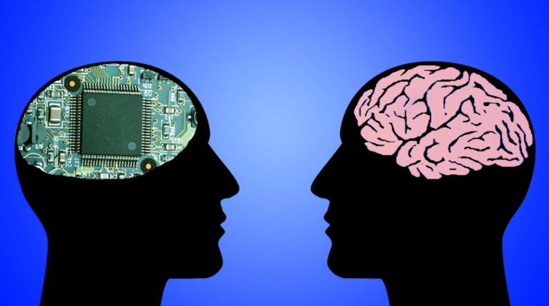

# Retos para contextualizar correctamente la IA y ser críticos con sus respuestas

Fuente:https://www.cambio16.com/uso-excesivo-de-ia-podria-disminuir-el-pensamiento-critico/

- [Requisitos vagos](./requisitos-vagos.md)
- [Algoritmos y complejidad](./algoritmos-y-complejidad.md)
- [Colecciones con criterio](./colecciones-con-criterio.md)
- [BD Relacionales en producción](./base-de-datos-en-produccion.md)
  
